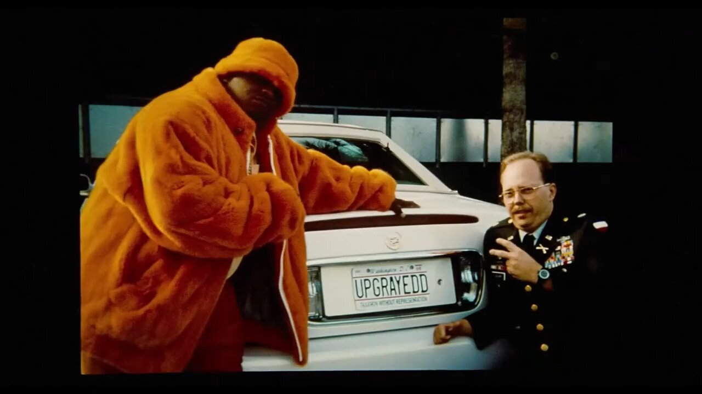

# PimpMyShell (P.M.S.)



**Exclusively for Windows 11.**

PimpMyShell dresses up the Windows 11 taskbar from the inside. It hooks the taskbar's own XAML in explorer.exe and
draws with it: under the buttons, over the blur. System meters, a hot-mic warning, notifications inside the taskbar,
a backdrop you can tune, glowing buttons.

## Get it

**[Download the Windows installer][releases]** (`pms-setup-VERSION.exe`, x64).

It installs for you alone, no administrator needed, into `%LOCALAPPDATA%\Programs\PimpMyShell`. You get a Start menu
entry for the settings, an entry in Settings > Apps, and (ticked by default) a start at sign-in.

Rather not install? The same release page has **`pms-portable-VERSION.zip`**. Unzip it anywhere and run `pmsd.exe`.
No Start menu entry, no start at sign-in (the tray menu can switch it on), and no self-updating.

The files aren't code-signed yet, so SmartScreen may warn you. Choose *More info* > *Run anyway*. Every release lists
the SHA-256 of each file in `SHA256SUMS.txt`.

[releases]: https://github.com/bungholesurfers/PimpMyShell/releases/latest

## What it works with

The taskbar that comes with Windows 11, and that's the whole list. PimpMyShell draws inside that taskbar's own XAML, so
it needs the real thing to be there.

- **Taskbar replacements** can't work with it: ExplorerPatcher or StartAllBack with their classic taskbar on, Start11's
  taskbar, or a bar of its own like RetroBar, Cairo or Seelen UI. There's nothing to hook, and nothing we can do about
  that. PimpMyShell tells you so once and lays low. Switch back to the Windows 11 taskbar and it picks up by itself.
- **Those same tools with their taskbar off**, used for a Start menu, say, are fine.
- **Mods of the Windows 11 taskbar**, like Windhawk's or TranslucentTB, often get along with it, but they hook the same
  thing we do. If something's off, try without them. We can't promise this one either.

## What you get

- **Meters** by the tray, from any Windows performance counter, with math over them:
  - CPU: a bar per thread, grouped by core, split into kernel time (at the bottom) and user time above it.
  - GPU: a bar per engine for every GPU, labelled and colored by maker (NV, RAD, INTC, QCOM, MSFT), with NVIDIA's
    power state (P0, P8...) when its driver is there.
  - Memory: RAM as a pie (in use, modified, standby), a VRAM pie per graphics card, and the pagefile only once RAM
    runs short.
  - Disk and network: write/read and up/down bars per disk and per interface. The disk Windows is on and the
    interface your internet goes through always show, first; the others join while busy, then fall off.
  - Your own: point a meter at any perf-counter path and write an expression, like `min(gpu, 100)` or
    `vram / vram_total`. Styles: history (a sparkline), bar (a gauge), pie, cores, engines, bars, disks, nics.
  - Bars can glow by how busy they are, or by how hot they've got. Hover any meter, or any GPU, disk or interface
    in one, for a tooltip that says what it is and what it's doing.
- **Hot mic.** While an app has the microphone open, the whole taskbar warns you. Then it settles into a label naming
  the apps, with sonar rings and the mic's loudness rising in the background: beside the tray, or first, before your
  meters and TVs, if you'd rather.
- **Your order.** Your meters, together, and each TV and Twatch TV go along the taskbar in the order you give them on
  Settings > Widgets, with the mic's label at whichever end you like.
- **Toasts in the taskbar.** Notifications show inside the taskbar instead of popping up. Their buttons work. The
  card glows in the app icon's color, rings ripple across the taskbar, and the clock stays in sight. New ones stack
  on top of the ones still showing, and you can flick a card off to the right to dismiss it. They stay as long as
  Windows would keep them: alarms, calls and reminders wait for your answer. Set `style = "pimped"` under `[toasts]`
  for gold cards with a sheen.
- **Your own backdrop.** Blur, tint and grain, with knobs. One look for dark mode, one for light, following Windows.
- **Glowing buttons.** Start and every app button glow when you point at them, brighter when pressed. Each app glows
  in its icon's color.
- **Settings** that show every option by its config name, with knobs that go to eleven. Changes apply as you make
  them.
- **A tray icon** to pause, open the settings, switch start at sign-in, read the log, or exit.
- **A watchdog** that backs off if explorer ever crashes with PimpMyShell in it.
- **Signed updates**, checked every day or two if you agree (or whenever you ask), installed only when you say so.
- **Out of the way when it can't be seen.** While a window fills the screen your taskbar's on, a game or a video, your TVs
  stop drawing, POOM rests, and Twatch TVs with their sound off stop: from about a quarter of a CPU thread to a few percent,
  back the moment the taskbar is. While a game's on (it fills the screen, keeps your graphics card busy, and somebody's
  playing, keyboard, mouse or controller), Twatch TVs make way too, and POOM stops unless you've been playing it. Both are
  on Settings > Power & performance.
- **Easy on the battery.** Unplugged, the hot-mic animation drops to 30 fps by default. `max_fps` caps it always.

## A TV in your taskbar

The last thing on the strip is a `screen`: a little TV, on by default, in the spirit of WindowMaker's dockapps. Point at it for
its remote: channel up and down, shuffle, and power. Shuffling TVs change channel every 30 seconds, or however often you set on any
remote or in Settings, which is for all of them. With jitter on, each is late by its own random amount, up to a quarter of that;
with it off, they all change together. Add as many sets as you like in Settings > TV, and move them along the taskbar on
Settings > Widgets.

On starting, each set flips up through its channels, from Captain Midnight's 1295 round to channel 6, and stays there. Settings > TV
changes where it starts and stops, or turns that off.

| Channel | |
|---|---|
| 2 | The test card |
| 3 | The crab, bouncing around and changing color, as a DVD player's logo does when it's left alone |
| 4 | Static |
| 6 | Space Pimpin', or POOM to its friends: a game console plugged into your TVs |
| 1295 | [Captain Midnight](https://en.wikipedia.org/wiki/Captain_Midnight_broadcast_signal_intrusion), who took over HBO's satellite feed in April 1986 over the price of scrambling |

Give the console a game on Settings > POOM and it's on channel 6. The demos
play in the taskbar. Click the picture to stop shuffling, then again to open a window and play: W, A, S and D or the arrows to
move, the mouse to turn and shoot, E or space to open doors. The console keeps running when
you change the channel, as a console does, and has a power button of its own. With nobody watching, it rests. Settings > POOM
fetches [Freedoom](https://freedoom.github.io/) or the Doom shareware episode, on request, or you can add your own IWAD. No
game data comes with PimpMyShell. Sound is off, and no audio device is opened.

On battery a TV you leave alone sleeps, holding its last picture and sending nothing, and wakes for 30 seconds when you touch it.
A sleeping TV costs what no TV does. On mains it runs at 60 frames a second, 30 while the machine stays busy, for a few percent of
one CPU thread in Explorer.

Turned off, any set stays for seven seconds, then shrinks to a small button: click it to turn the set back on.

### Twatch TV

A Twatch TV is a 16:9 flat-screen set that keeps an eye on your favorite Twitch channels, in the order you put them, and plays the
best one that's live as live video in the taskbar. It's off until you turn it on in Settings > Twatch TV, and there's no sign-in,
API key or client ID. Pointing at the set brings up its remote: what's on and how well it's playing, power, sound (off to begin
with), channel up and down, and your favorites, live ones lit. Clicking the picture opens the channel.

- Your favorites live beside your settings, in `pms-twatch-watchlist.txt`: one channel per line, best first, as names, @names or
  twitch.tv links, with `#` for comments. A line that can't be a channel is skipped and pointed out, and the rest carry on.
- Finding out who's live is one small request for a channel's preview picture on Twitch's CDN. Every favorite gets one about
  every 10 minutes, plus a random wait of up to 5 minutes picked afresh each time, whatever its place in the list. They go in no
  order, one at random of those due, spread out so that no two come together, and nobody's looked at again before their wait is
  up. At the start, those never looked at go a few seconds apart, so the sets know who's live within moments. Settings can change
  both, and it's all twice as long on battery.
- Each set follows your favorites, stays on its channel until that ends, or only ever shows one channel, with no signal until it's
  live. Its remote has a key for each, and says what'll happen, in so many words: "Switches if crab goes live", or "Only ever shows
  crab: no signal until they're live". Settings says what sets do by default. Picking a channel from the remote stays on it until
  it ends; on a set kept to one channel, it changes which. The remote also sets the highest quality, for every set.
- With more favorites live than sets, a purple plus beside them says so, and adds a set for good. Or Settings can have sets come and
  go by themselves, up to two more, and an A beside them says that's on and leads to the setting.
- A notification says when a favorite goes live, unless you turn that off.
- Pictures can stand in for video, only when RAM or VRAM is low (the usual), until you click a set, always, or never. Pictures need
  no Streamlink, and show on battery whatever you've chosen.
- Live video needs [Streamlink](https://streamlink.github.io/), which Settings downloads on request from the project's
  [Windows builds](https://github.com/streamlink/windows-builds): the newest stable release, taken only if GitHub says its own
  runners uploaded it, and only if it hashes to the digest GitHub keeps for it. That proves it's the file the project published,
  not that it's safe, so nothing newer is ever installed unasked. Streamlink reads Twitch's website, which changes without
  warning, so if it can't open a channel that's live, PimpMyShell asks GitHub whether there's a newer release, at most every six
  hours, and tells you: getting it is your call, in Settings. Prefer no extra program? Turn on pictures, and the set shows a still
  every minute instead.
- Off the mains, a set shows a new picture every minute instead of video, and goes back to video when you plug in.
- It plays up to 480p by default, and up to 1080p60 if you ask. While your PC stays busy, or the stream keeps stalling, it steps down, a very small light
  shows on the set, and the remote says why. The network can lower it too, by itself.
- With more sets allowed, up to two more appear as more favorites go live and their streams start, and go away afterwards.
- When a stream has a problem, the set shows No Signal and keeps trying.
- Each set starts with a second of its logo.
- When Windows turns the display off, muted sets stop streaming and keep their last picture, and pick up again a few seconds after
  it's back. A set with its sound on keeps playing, as sound only. The console carries on as it was.
- When memory runs low (90% of RAM in use or committed) or video memory does (69% of a card's own), the players are evicted, and
  each set says so, under a very sad little TV. With RAM low the console goes too, unless it's been played since it last started:
  closing that could lose a game, so it stays until it's restarted, and a notification says so. It doesn't use the GPU, so VRAM is
  nothing to it. Everything comes back by itself once things have been fine for a minute.

Windows can't take a DLL back out of a running process, so each new build Explorer meets stays in it until Explorer restarts. Once
it has at least 10 of them and 300 MB of memory, a notification says so, and Settings can turn that off. Explorer never restarts
by itself. Asked to, from that notification, from Settings or with `pms restart-explorer`, it won't with a folder window, file copy
or Explorer dialog open in the taskbar's process. It asks Explorer to leave, the way Exit Explorer does, and your taskbar is back
in a few seconds.

The player is `pms-twatch.exe`, its own process, using Windows' own media stack. The video never touches a window: frames are
scaled down on the GPU and handed over in shared memory, like the console's.

The console is `pms-poom.exe`, its own process, so a crash can't touch your taskbar. It's the engine from
[room](https://github.com/sunsided/room), and it's under the GPL version 2, unlike the rest of PimpMyShell: its source is in
[`pms-poom`](pms-poom), and it shares nothing with the MIT parts but frames in shared memory (`pms-screen`).

## Using it

Your settings live in `%APPDATA%\PimpMyShell\pms.toml`, in the roaming profile, so they follow you to another PC. It holds
only what you've changed; everything else comes from the defaults, so better defaults still reach you with an update.
`pms.example.toml` is those defaults, and explains every option. Edit it by hand or in the settings window (left-click
the tray icon). The daemon picks up changes within a second. (Before 0.1.3 it lived in `%LOCALAPPDATA%\PimpMyShell`; one
there moves over by itself the first time. Before 0.1.4 it held every setting: the first run keeps only what differs from
every default we've shipped, and the whole file stays beside it as `pms.toml.full.bak`.)

The settings window is a WinUI 3 one (the Settings app's look: a pane of pages and a card per setting, over acrylic with dollar bills and sound investment advice drifting through the pane and blurred behind the settings, which, per the General page, is not investment advice) wherever the
PC has Microsoft's Windows App Runtime, which many PCs have from Store apps; PimpMyShell doesn't install it. Without it,
the same `pms-gui.exe` shows the classic (egui) window, which edits the same settings the same way; `pms-gui --egui`
asks for that one anyway, and each window has a button that opens the other. PimpMyShell's questions (software update's,
a notice's explanation, *Install X*) come as small windows of the same look where it can, else as task dialogs.

A first run on a new config opens a short welcome: how notifications should look, whether to ask before they open
anything, updates, and starting at sign-in. The General page has it again. Every part of the settings has a Reset, with a
confirmation, in both windows. A reset leaves your own decisions alone, and says which: whether to check for updates,
taskbar notifications being off, Ask before opening, and the lists of apps you've excluded.

The tray icon's menu:

| Item | What it does |
| --- | --- |
| Settings | opens the settings (a left click does too) |
| Pause | puts the standard taskbar and notifications back until you resume |
| Try again | in Pause's place, only after the watchdog backed off (below) |
| Start when I sign in | the HKCU Run value, on or off |
| Check for updates | checks now; once a new version is downloaded and checked, *Install PimpMyShell X…* (asks first); a portable copy offers *PimpMyShell X is available…*, which opens its page |
| Open log | `daemon.log` in Notepad |
| Save a report | saves `pms-report.txt` beside the logs, shows it, and offers to open GitHub (issues there are public) |
| Exit | stops the daemon, which puts the standard taskbar back |

Toasts need notification access. Windows asks the first time; it lives under Settings > Privacy & security >
Notifications. While it's off, notifications stay Windows', and a card of PimpMyShell's own in the taskbar says so
every 5 minutes; click it for the fix. They come to the taskbar within seconds of turning it on. Or click *Keep
Windows notifications* there: the taskbar's toasts go off (`enabled = false` under `[toasts]`; the settings' Notifications
page turns them on again), and so does the reminder.

The same kind of card tells you of the few other troubles that need you: a `pms.toml` that didn't load (click it for
the line and what's wrong with it, and a button that opens the file), or toasts that couldn't start. With toasts off
in the config, or a stock taskbar, a Windows notification says it instead.

## Is it safe? What does it change?

PimpMyShell is **unofficial**. It pokes undocumented internals of explorer.exe. A Windows update can rename or
rearrange the taskbar's insides and break it. When that happens, the worst case should be a stock taskbar: the
watchdog stops hooking explorer if it crashes with PimpMyShell inside (see below). Still, you're running code inside
your shell. Keep that in mind.

What it touches, all under your own user (no admin, no services, no drivers):

- **`HKCU\Software\Microsoft\Windows\CurrentVersion\Run`**, value `PimpMyShell`: start at sign-in. Off by unticking it
  in the tray or the installer.
- **`HKCU\Software\Classes\AppUserModelId\PimpMyShell`**: the name and logo PimpMyShell's own notifications go out
  under (the watchdog's warning, say).
- **`HKCU\Software\Microsoft\Windows\CurrentVersion\Notifications\Settings\<app>`**, value `ShowBanner`: with in-taskbar
  toasts on, the native popup of every app that can notify is switched off. The original value is written down in
  `banners.txt` *before* it's changed, and put back when the daemon stops, pauses, or turns toasts off. If the daemon
  crashed, the next start puts them back first. For an app that had never notified there was no key: PimpMyShell
  creates it, and deletes it again only if it's still exactly as left (no values, no subkeys). Once the app has
  notified, Windows has filled the key in and it stays, as it would have anyway.
- **`HKCU\Control Panel\NotifyIconSettings`**: on the first start of each copy (each exe path), the tray icon is
  promoted out of the overflow, once (`tray-pinned.txt` remembers). Hide it again and it stays hidden.
- **`%APPDATA%\PimpMyShell`**: `pms.toml`, `pms.toml.bak` (the settings window's copy of it from before its first save),
  `pms.toml.full.bak` (the whole file, from before it held only your changes), `pms.toml.last-good` (the last settings that
  loaded), `pms-twatch-watchlist.txt` (your Twatch TV favorites), `pms-network.toml` (a proxy, and what goes through it),
  `tv.txt` and `twatch.txt` (each TV's channel, power and sound, as you left them: they go with the sets named in `pms.toml`).
  Your favorites and network settings are kept out of `pms.toml` so that you can share it for help without them. A setting in
  `pms.toml` that can't be used (misspelled, one an older version knew, or a value that isn't one of the choices, is out of
  range, isn't a color or is the wrong kind) goes back to its default, or is left out, and the rest loads. A notification says
  so, and Settings marks each in red, with its page.
- **`%LOCALAPPDATA%\PimpMyShell`**: this PC's own files: `logs` (`daemon.log` and `tap.log`, each line timed in UTC, as
  `2026-11-09T18:21:33.512Z`, which says nothing of where you are; Settings > Logs lists what else they can say about you.
  Each is rotated at 1 MB with two
  older generations kept, `daemon.1.log` and `daemon.2.log`; about 3 MB each at most. They're here, not in the roaming
  profile, as they're about this PC and written all the time: where the roaming folder is redirected to a network share,
  each line from inside Explorer would be a network write), `banners.txt`, `tree.txt` (a
  dump of the taskbar's visual tree), `update-checked.txt` (when updates were last checked), `taskbar-told.txt` (whose
  replaced taskbar we've explained, so that it's only once), `welcomed.txt` (the welcome has been offered), `pms-128.png`,
  `tray-pinned.txt`, `seashell-carried-over.txt` (SeaShell's settings have been brought over once, and never come back),
  `vidya` (games, each in a folder of its own: `vidya\poom` is the console's, with its games in `wads` and its settings and
  saved games), `streamlink`, and `tap\pms_tap-<stamp>.dll` (see below).
- **`%TEMP%\pms-update`**: a downloaded update, until it's installed.

It reads, but never writes, the notification database (`wpndatabase.db`), to get a toast's full content.

Settings > Network lists everything PimpMyShell uses the network for, with what goes where: update checks; downloads you ask
for (games, and Streamlink); and, with a Twatch TV, who's live, Streamlink finding streams, and the video itself. It sends
nothing but the requests themselves: no account, no analytics. Update checks wait for your answer: a minute into the first run,
PimpMyShell asks whether it may check by itself. *Check automatically* lets it check a while after each start and then every day
or two, *Don't check* turns that off, and closing the question answers nothing, so it asks again at the next start
(`update_check` in the config, or the settings' *software update*, changes it later). You can also check from the tray or the
settings. A check starts by reading `https://raw.githubusercontent.com/bungholesurfers/PimpMyShell/main/update/stable.txt` (on
the latest channel, `https://github.com/bungholesurfers/PimpMyShell/releases/latest`), and goes on to the release only when that
names a newer version.

Any of it can go through a SOCKS5 proxy (`socks5h://` looks names up there too), each use switched on or off, Streamlink and the
video included: Streamlink is told to use it, and the video is fetched by PimpMyShell itself, through the proxy, instead of by
Windows. Finding a stream and playing it always go the same way, as Twitch's address for a stream names the IP address that asked.
For Tor, each use can go with a random user name and password of its own, for stream isolation. What's switched on never goes
without the proxy: if it can't be reached, that fails, and if `pms-network.toml` won't load, nothing goes online until it's fixed,
and a notification says so. Nothing is airtight, least of all software PimpMyShell gets for you from elsewhere, like Streamlink:
if it matters, Windows Firewall or another filter on the Windows Filtering Platform can keep `pmsd.exe`, `pms-gui.exe`,
`pms-twatch.exe` and `streamlink.exe` to your proxy.

**Turning it off:** tray > *Pause* for a stock taskbar right now, tray > *Exit* to stop. `pms daemon stop` does the
same from a console.

**Uninstalling:** Settings > Apps > PimpMyShell. The uninstaller stops the daemon (stock taskbar and banners back),
removes the Run value and its Task Manager startup mark, the notification registration, `%TEMP%\pms-update`, and the
logs, `tree.txt`, `update-checked.txt` and `taskbar-told.txt` (each by its exact name). It keeps `pms.toml` (your config, in
`%APPDATA%\PimpMyShell`), and `banners.txt` in `%LOCALAPPDATA%\PimpMyShell`, along with small leftovers (`pms-128.png`,
`tray-pinned.txt`, the `tap` folder). Delete those folders by hand if you want them gone. A TAP stays loaded, inert, in the running explorer until explorer restarts or you sign out: it's a hard link to the installed DLL, not a copy, so it takes no room and no writing, and it lets an update replace that DLL while Explorer still has it open.

## How it diddles Explorer

The Windows 11 taskbar is a system XAML (`Windows.UI.Xaml`) island hosted inside explorer.exe. PimpMyShell gets a DLL
into that process through the front door Microsoft built for Visual Studio's Live Visual Tree, and then edits the
taskbar's element tree from inside.

```
 pmsd.exe (daemon, your session)                         explorer.exe
 ├─ config, hot reload                                   └─ pms_tap.dll (the "TAP")
 ├─ PDH / DXGI / NVML sampler    \\.\pipe\pms-tap           ├─ IVisualTreeService3 (mirror of the taskbar tree)
 ├─ mic watch (consent store)  ─── length-prefixed ───▶     ├─ command interpreter on the pipe thread
 ├─ toast listener + banners      text commands             └─ XAML / Composition work on the UI thread
 ├─ watchdog (exit code, event log)
 └─ tray icon
```

### The crates

| Crate | What it is |
| --- | --- |
| `pms` | the daemon (`pmsd.exe`, windowless; `pms.exe daemon` in a console), the `pms` command line, config, sampler, watchdog, tray, updater |
| `pms-tap` | `pms_tap.dll`, the TAP loaded into explorer. Draws everything in the taskbar and serves the pipe |
| `pms-xaml` | a `windows-bindgen` projection of the slice of `Windows.UI.Xaml` it needs. windows-rs stopped shipping XAML, but its metadata still describes it |
| `pms-gui` | the settings: WinUI 3 (windows-reactor) where the Windows App Runtime is installed, else egui, over one model; and `--ask`, the daemon's questions as WinUI 3 windows |
| `pms-ui` | widgets the settings and the art tool share (the knobs) |
| `pms-art` | renders the icons and the installer's pictures from `art\` |
| `pms-res` | puts the icon and version info into the exes |
| `pms-recon` | step zero: dumps the HWND tree of every taskbar, to see what hosts what (system XAML vs. WinUI 3) |
| `xtask` | the build tasks |

### Getting in: `InitializeXamlDiagnosticsEx`

`Windows.UI.Xaml.dll` exports `InitializeXamlDiagnosticsEx(endpoint, pid, dll, tapDll, tapClsid, initData)`. It's the
XAML Diagnostics entry point: given a process id and a DLL, XAML in *that* process loads the DLL, creates a COM object
from it by CLSID, and hands it an `IXamlDiagnostics` site. That DLL is a TAP ("Tool/Test Attach Point").

`pms inject` (and the daemon) does this:

1. Finds explorer's pid from `Shell_TrayWnd`, but only once it has its
   `Windows.UI.Composition.DesktopWindowContentBridge` child, i.e. the XAML island exists.
2. Asks any TAP already there to `detach`.
3. Copies `pms_tap.dll` to `%LOCALAPPDATA%\PimpMyShell\tap\pms_tap-<timestamp>.dll`. Explorer keeps every copy it loaded
   locked until it exits, so each injection gets a fresh copy. Old copies get swept up when they're no longer loaded.
4. Calls `InitializeXamlDiagnosticsEx` with that copy and the TAP's CLSID, trying endpoint names
   `VisualDiagConnection1..100` until one isn't taken.
5. Waits for the new TAP to open its pipe and answer `ping`.

### Inside: the TAP

The TAP is a plain COM object implementing `IObjectWithSite` and `IVisualTreeServiceCallback2`, exported through
`DllGetClassObject`. The XAML Diagnostics interfaces (`xamlom.h`) aren't in windows-rs, so they're hand-written in
`pms-tap/src/xamlom.rs`, vtable order and all.

- **`SetSite`** receives the site and casts it to `IVisualTreeService3` and `IXamlDiagnostics`.
- **`AdviseVisualTreeChange`** replays the whole existing tree through `OnVisualTreeChange` and then reports every
  add and remove. It must be called from another thread: called from `SetSite` (on the UI thread) it deadlocks.
- The TAP keeps a **mirror** of the tree: handle, type, name, parent, child index. Commands find elements in it by
  name or type (`BackgroundFill`, `TaskListButton:2`), and it's dumped to `tree.txt` when it changes.
- **`GetDispatcher`** gives the island's `CoreDispatcher`. Anything touching XAML is posted to the UI thread with
  `RunAsync`, waited on for at most 5 seconds, and wrapped in `catch_unwind`: a Rust panic unwinding into XAML would
  take explorer with it.
- `DllCanUnloadNow` always says no. The TAP leaves threads running, so COM must never unload it. A detached TAP calls
  `UnadviseVisualTreeChange` and goes inert.

The diagnostics API can also read the property chain (`GetPropertyValuesChain`), create objects from strings
(`CreateInstance`), and `SetProperty` / `ClearProperty` / `AddChild` / `RemoveChild`. For real drawing, the TAP gets
the live object behind a handle (`GetIInspectableFromHandle`) and uses the generated `pms-xaml` bindings like any XAML
app would.

### The layer cake

On the builds PimpMyShell was made on, the taskbar's background looks like this:

```
TaskbarFrame
└─ RootGrid
   └─ BackgroundControl
      └─ Grid
         ├─ BackgroundFill        Rectangle, Fill = the stock AcrylicBrush (blur, tint and noise in one effect)
         └─ BackgroundStroke
   (the buttons live in a later sibling, so anything in this Grid sits under them)
```

The TAP inserts its own elements into that Grid, right after `BackgroundFill`, always in this order:

```
BackgroundFill, [Backdrop host], [Alert host], [Stage canvas], [Grain host], BackgroundStroke, ...
```

- **Backdrop.** The stock `AcrylicBrush` bakes blur, tint and grain into one effect, so nothing can go in between.
  With `[backdrop]` on, the TAP parks the stock brush (keeping a strong reference, to put it back later), sets
  `BackgroundFill.Fill` to a transparent brush, and hands its own composition tree to an empty Grid with
  `ElementCompositionPreview.SetElementChildVisual`:
  - a `SpriteVisual` with a `HostBackdropBrush` (DWM's already-blurred desktop),
  - a tint `SpriteVisual`,
  - a "layer" `SpriteVisual` for washes and pulses,
  - a container that paints the free gaps between buttons (it follows layout changes),
  - and, in the Grain slot further up, tiles of noise: a 512x128 grayscale PNG generated at startup, loaded through
    `LoadedImageSurface`. The grain knob is that visual's opacity.

  DWM only feeds a host backdrop to windows that opted in, and only takes the opt-in from the process that owns the
  window. So the TAP itself sets `DWMWA_USE_HOSTBACKDROPBRUSH` on explorer's `Shell_TrayWnd` and
  `Shell_SecondaryTrayWnd` windows.
- **Alert slot.** The hot-mic alert: a `ShapeVisual` with a breathing rounded-rect wash and sonar-ring ellipses. The
  toast ripple and the button glows sit here too.
- **Stage.** A hit-test-invisible `Canvas` holding the meter strip. Above the blur and the alert, below the grain, so
  meters get grained like the rest of the taskbar.

Because the pointer never reaches the stage, meter tooltips use transparent hover zones placed in the top-level Grid
(the one holding `TaskbarFrame` and `SystemTrayFrame`), and a windowed `Popup` that can stand above the taskbar.
Toast cards go in that Grid too, over the tray (the cards behind the front one peek out at its left). The tray fades
away while they show.

Where things fit comes from **layout tracking**: on every `LayoutUpdated` the TAP measures the children of
`TaskbarFrameRepeater` and `SystemTrayFrameGrid` and works out the free stretches. The meter strip fits itself into
the space beside the tray. When it runs short, it squeezes spacing, then graphics, then text width, then hides meters
from the end of the list.

**Glows.** The Start button (`LaunchListButton`) is a `ToggleButton`: the TAP listens to its `IsPointerOver`,
`IsPressed` and `IsChecked` (Start menu open) with `RegisterPropertyChangedCallback`. App buttons (`TaskListButton`)
take pointer events instead. Each app's color comes from rendering its icon with `RenderTargetBitmap` and picking the
most prominent hue.

**Frame pacing.** The compositor runs keyframe animations at the display's rate and has no setting for a slower one.
So `pace <fps>` samples a long-running animation into held steps, and nothing on screen changes between them.

### The pipe

The TAP serves `\\.\pipe\pms-tap`:

- one instance at a time (`FILE_FLAG_FIRST_PIPE_INSTANCE`, so a stale TAP can't share it), remote clients rejected,
- a DACL of SYSTEM and the owner only,
- each request and each response a frame: a little-endian `u32` length, then UTF-8 text,
- a request is a command line: `status`, `reset`, `backdrop tint #7F060606`, `meters push ...`, `toast show ...`.
  `batch "<cmd>" "<cmd>" ...` runs several in one UI-thread job, one layout pass.

The daemon opens a fresh connection per request, so nothing hogs the single instance. `pms` with no arguments is a
REPL against the same pipe, and `pms help` lists the commands, including raw tree surgery like
`pms props BackgroundFill/Fill` and `pms set <elem> <Prop> <value>`.

### The daemon's loop

`pmsd.exe` holds a single-instance mutex and sleeps in `WaitForMultipleObjects` on a stop event, the mic watcher's
registry event and the tray's event, waking for whichever is due: meter intervals, mic levels, toast polls. Once a
second it reconciles:

1. **`status`.** The TAP answers `tap=<copy id> build=<hash> taskbar=<BackgroundFill handle> backdrop=.. alert=..
   meters=N toast=..`. The UI-thread hop doubles as a liveness check.
   - No pipe at all (first run, explorer restarted): **inject**, once the taskbar's island exists, at most every
     5 seconds.
   - Three failed exchanges with a TAP that's there: replace it.
   - A TAP of another build (`build` is a hash of the TAP DLL's bytes; the daemon hashes the `pms_tap.dll` beside it):
     **swap ours in**. After an update explorer still has the TAP it loaded before, which may not speak the new
     daemon's protocol, so toasts would fail while their native banners are off. Swapping doesn't count against
     the hook, and every update takes effect without restarting explorer. If two swaps in a row don't take, that TAP
     keeps the rest of the config but not the toasts: native banners stay on until explorer restarts.
   - A TAP copy or taskbar tree it hasn't configured, or one that drifted from the config (someone ran `reset`):
     **`reset`**, then apply the whole config again.
2. **Config hot reload.** When `pms.toml`'s modified time changes, it's loaded and validated. Only the sections that
   changed are re-sent, in one batch, so saving from the settings doesn't flash the taskbar back to stock. A broken
   file keeps the previous config, and a notice (`notices.rs`) says what's wrong. One broken at the start doesn't stop
   the daemon: it starts with a stock taskbar, until a save that loads.
3. **Theme and power.** It follows `SystemUsesLightTheme` (with `theme = "auto"`) and switches between the dark and
   light looks. On battery (`GetSystemPowerStatus`) it lowers the animation cap.
4. Then the hot mic, toasts and meters (below).

Exit, `pms daemon stop`, or Ctrl+C sends `reset` (stock taskbar) and restores the banners. The TAP stays loaded,
inert, until the next daemon.

### Where the meter numbers come from

- **PDH.** Counters are added with `PdhAddEnglishCounterW`, so configs use English paths whatever the display
  language. Wildcard instances (`\Network Interface(*)\Bytes Received/sec`) are aggregated with `sum`, `max`, `min`,
  `avg`, or `engine` (per-engine sum, then the busiest engine, the way Task Manager computes GPU %), skipping `_Total`.
  Meters that share an interval share a PDH query, collected only when that interval comes round. `typeperf -q`
  lists the paths.
- **Expressions.** A tiny parser: `+ - * /`, parentheses, `min`, `max`, `abs`, over counter names and builtins
  (`ram_total`, `vram_total`, `swap_total`, `swap_used`, `cpu_count`).
- **CPU threads.** Per-CPU busy time from `QueryIdleProcessorCycleTimeEx` against the TSC. The user/privileged time
  counters only move in whole timer ticks, so they just decide the user/kernel split. Grouping comes from the CPU topology
  Windows reports.
- **GPUs.** DXGI enumerates the adapters (software ones like WARP left out unless asked). `per_gpu = true` turns one
  meter into a pie per adapter with at least `min_memory_mb` (1024) of dedicated memory, reading `\GPU Adapter Memory(luid_..._phys_*)\Dedicated Usage`
  against the adapter's size. The maker comes from the adapter's name. An engine counts as working from 0.5% (the
  desktop keeps some at a trace); with `engines_fall_off`, idle engines leave one by one, not only whole GPUs.
- **Disks and network interfaces.** `\PhysicalDisk(*)` and `\Network Interface(*)` per instance. A disk's instance
  is its number and drive letters (`0 C: D:`); the one holding the Windows folder is the system disk. Its model and
  bus come from `IOCTL_STORAGE_QUERY_PROPERTY` (no access to the disk itself needed). An interface's instance is
  its adapter's description with `(` `)` `#` `/` `\` respelled, matched against `GetAdaptersAddresses` for its name,
  kind, link speed and addresses. The internet one is where `GetBestInterfaceEx` routes 1.1.1.1 (IPv6: Cloudflare's
  2606:4700:4700::1111), which asks the routing table and sends nothing. That one and the system disk always show,
  first. The rest show while busy (2 KB/s or more), busiest first, and leave `hold_seconds` after going idle. The
  order is worked out again only when one comes or goes, so bars don't swap under the pointer.
- **Tooltips.** A hover zone covers each meter at the taskbar's full height and reaches into the spacing around it.
  GPU and device meters get one per GPU or device. The daemon writes those tooltips: a GPU's name, power state and
  busy engines; a disk's role, rates, model and free space; an interface's role, rates, adapter, link speed and
  addresses.
- **NVML.** If NVIDIA's driver is installed, `nvml.dll` is loaded at runtime for each GPU's performance state. No
  NVIDIA, no NVML, no problem.

### Hot mic

The same source as Windows' own mic indicator: the capability consent store,
`HKCU\...\CapabilityAccessManager\ConsentStore\microphone`. Every app that ever used the mic has a key there (packaged
apps by family name, others under `NonPackaged` by path) with `LastUsedTimeStart` and `LastUsedTimeStop`. While an app
holds the mic, `LastUsedTimeStop` is 0. `RegNotifyChangeKeyValue` wakes the daemon on any change, so the warning
shows up at once.

App names come from the exe's `FileDescription` or the package's display name. While the mic is hot, the daemon reads
every active capture endpoint's `IAudioMeterInformation` peak about 15 times a second, plus the default endpoint's mute,
and feeds them to the alert. Apps that mute themselves (Discord, Teams) still read as live: Windows can't see that.

### Device names

The taskbar names devices the way Windows does inside. A network interface goes by its LUID's name, the closest thing
Windows has to Linux's `eth0`: `ethernet_32773` (what `Get-NetAdapter` calls `InterfaceName`) shows as `eth5`, and
`wireless_32768` as `wlan0`, counting from the 32768 that Windows starts at. A disk goes by its device name:
`\\.\PhysicalDrive0` shows as `disk0`, the number diskpart and Disk Management use. The tooltips give the full names.

### Toasts

- **Source.** `UserNotificationListener` works unpackaged once you allow notification access. Its change event needs
  package identity, so the daemon polls, but not the listener: twice a second it reads, from the notification platform's
  `wpndatabase.db`, the newest notification's id and how many there are, a read of a file that costs Windows nothing, and asks
  the listener only when those change (and every 30 s, in case). Asking it has WpnUserService gather every notification in the
  center each time: about 57 ms of its CPU with 260 of them, and on some PCs a stream of writes to that database's log
  (`wpndatabase.db-wal`). The listener only exposes text, so the full toast XML
  (images, buttons, launch arguments) is read from the notification platform's `wpndatabase.db` by the same id,
  read-only. Without access (or once it's taken away), no banner is turned off, a notice says so, and the daemon
  tries again every 15 seconds.
- **How long a card stays.** `duration_ms`, or at most 4 seconds when a card comes forward with more behind it.
  `duration="long"` gets at least 25 seconds. The `alarm` and `incomingCall` scenarios, and `reminder` with a button
  (Windows ignores the scenario without one), have no time limit, as in Windows: they stay until you answer them, or
  until the app takes the notification back. `urgent` only gets past do not disturb, so it times out like any other.
- **When the taskbar won't take a toast.** With native banners off it would go missing. One refusal may be a glitch or
  one app's odd toast, but two in a row give every banner back to Windows, and a notice says so, as a Windows
  notification. The taskbar gets another try after 5 minutes, then after twice as long each time it refuses, up to an
  hour; the first toast it shows ends all that. Cards and meter tooltips go in the nearest Grid above the tray, which is normally its parent; if not, the
  TAP's log names what's between them.
- **When something keeps failing.** Three failures in a row to set up or feed the meters raise a notice asking for a
  report: your Windows version, the logs and settings, and the taskbar's layout, redacted like the logs. *Save a report* in
  the tray menu makes the same file any time. Nothing is sent: the report is saved beside the logs, and a window explains
  that GitHub issues are public before offering to open GitHub.
- **Reports.** The daemon's log starts with the Windows version, then, for each explorer, the versions of what we hook
  (`explorer.exe`, `Taskbar.dll`, `Taskbar.View.dll`, `Windows.UI.Xaml.dll`), the taskbar software it knows, and every
  third-party DLL in explorer. File names and versions only, not paths. Both logs leave out your Windows user name
  (paths show `%USERPROFILE%` or `<user>` instead) and what your notifications say: a toast is logged by its app's name
  alone, and a link it opened by nothing more than its scheme.
- **Native banners out of the way.** `ShowBanner=0` under an app's `Notifications\Settings\<AUMID>` key takes effect
  live: the notification still reaches the center (and the listener), but the popup is gone. Set ahead of an app's
  first notification, it holds that one back too. So the daemon sets it for every app that has notified, and also for
  every app that could: the Start menu's apps (packaged ones, and shortcuts carrying an app id, like Telegram's or
  Discord's) plus the ids registered under `Classes\AppUserModelId` (Firefox's, Windows' own senders). It looks
  again every 10 minutes for newly installed apps. Restoring is as described above.
- **Every kind goes through one platform.** Modern toasts (WinRT, Windows App SDK, browsers' web push), Windows'
  own system toasts, and the old tray balloons (`Shell_NotifyIcon` with `NIF_INFO`, and `IUserNotification`),
  which Explorer turns into toasts. All of them show up in the listener and go to the taskbar. Try them all with
  `cargo run -p pms --example toast_lab -- register` once, then `-- everything` (or `all`, `shell`, or kinds by
  name; `--gap 4` first to space them out); `notif_probe` shows what the listener and the database hold.
- **Two exceptions.** A tray icon's balloons get an id Explorer makes up (`NotifyIconGeneratedAumid_<hash>`) at
  its first balloon, so each tray icon's first balloon still pops natively. And a toast an app sends silently
  (`SuppressPopup`, straight to the center) looks like any other to the listener, so it shows in the taskbar.
- **A deck.** A toast that comes while others show goes on top. The ones behind step back: shorter, fainter, their
  insides hidden, and clipped to a sliver that peeks out at the front card's left (the cards are translucent, so
  anything more would show through). When the front card goes, the next comes forward, with at most 4 s while more
  wait behind it. Up to 8 cards; older ones are let go (they're still in the notification center).
- **Swiping.** Drag the front card: it follows the pointer, fading as it goes right, and gives a little to the left.
  What's under it shows as it goes: the card behind comes forward, whole wherever the front card has moved off it,
  or, with none behind, the tray fades back in.
  Let go past 40% of its width, or flick it right, and it flies off at the speed it was thrown, slowing as it goes;
  that dismisses it, like its x. Otherwise it springs back (a composition spring, carrying the release speed).
- **Clicks and swipes** on a card are queued in the TAP with the card's id; the daemon collects them. A click on the card
  or a button activates the app the way Windows would: its `INotificationActivationCallback` COM activator, a protocol
  URI, or launching a packaged app with the toast's arguments; a swipe or the x just dismisses it. An unpackaged app
  with no activator can only hear of a click through a handler in its own process, which nothing outside it can reach,
  so it's started as its Start menu entry would be.
- **Asking first.** `confirm_clicks` under `[toasts]`: `"card"` turns the card itself into the question, with what it
  would open and NO and YES; `"window"` asks in a window at the corner, with room for every path and argument; `"off"`
  doesn't ask. *SHUT UP, COMPUTER* makes it `"off"`. A card that's asking stays until it's answered.
- The card leaves at once; the next one's countdown starts when the daemon says (`toast front`).
- Do not disturb and full-screen apps still hold toasts back (`SHQueryUserNotificationState`).

### The watchdog

PimpMyShell never brings back an explorer that was simply ended: Task Manager and `taskkill` leave exit code 1, and
people do that on purpose. A **crash** is another matter. The daemon holds a handle to the explorer it hooked:

1. Explorer exits with an exception code (`0xC...`, at least `0x80000000`): a crash.
2. The daemon looks up the matching **Application Error, event 1000** record in the Application log (same app, same
   pid) and reads the faulting module.
   - `pms_tap*`, or XAML / composition modules the TAP drives (`Windows.UI.Xaml.dll`, `dcomp.dll`,
     `CoreMessaging.dll`, ...): bench at once.
   - Anything else: once is explorer's own business. Twice within 10 minutes: bench.
3. Hooking that keeps failing benches too: 3 failed injections in a row, or a TAP that had to be replaced 3 times in
   the same explorer (not counting swaps for a new build).
4. Windows normally restarts a crashed shell. If it hasn't within 12 seconds, the daemon starts explorer.exe, but only
   after a crash, never after it was ended.

**Benched** means: `reset` to the stock taskbar, native banners restored, the TAP told to `detach`, and no more
hooking for the rest of this run. You get a notification saying why, and the tray menu offers *Try again*,
which forgets the strikes and starts over.

### The updater

Nothing installs without you saying so.

- **When.** A minute into the first run, the daemon asks whether it may check by itself: *OK*, or closing the
  question, is yes; *No, don't check* is no. Unanswered, it checks nothing, and asks again next run. If yes, it checks
  a while after each start (1 to 30 minutes, at random) and then every 24 to 48 hours (2 to 6 after a failed check).
  The time of the last check is kept, so signing in again doesn't check again. *Check for updates* in the tray menu
  and the settings' *software update* checks right away.
- **Telling you.** A new version is downloaded and checked, then a notification says it's ready and the tray menu
  offers *Install PimpMyShell X…*, which asks first. A check from the settings ends the same way, with *Install X and restart*.
- **What's new.** The *stable* channel (`update_channel = "stable"`, the default) reads a tag from `update/stable.txt`
  on the repo's main branch. The *latest* channel takes the newest release, its tag read off where GitHub's
  `/releases/latest` redirects (a HEAD request). Only a version newer than the running one counts, except for the
  settings' *Reinstall stable* and *Reinstall latest release*, which fetch that version whatever this one is (still
  only as its signed manifest describes it, and still asking before installing).
- **Signed manifest.** Each release carries `pms-update.json` (version, installer name, size, SHA-256) and
  `pms-update.json.sig`, an Ed25519 signature over the manifest's exact bytes. The updater believes the manifest only
  if a public key compiled into `pms/src/signing.rs` verifies it (`verify_strict`), it names the very version asked
  for, and the installer is named `pms-setup-<version>.exe`. The tag itself is unsigned: at worst it can hold updates
  back.
- **Download.** Into `%TEMP%\pms-update`, size capped, hashed while it streams. Kept only if the size and SHA-256
  match the manifest. Hashed once more right before it runs, since it sat in `%TEMP%` meanwhile, and held open
  against writing from that hash until the installer has started.
- **Network.** HTTPS only, to GitHub's hosts only (`github.com`, `raw.githubusercontent.com`,
  `objects.githubusercontent.com`, `release-assets.githubusercontent.com`). Redirects are followed by hand and each one
  is checked the same way: no other host, no user, no port. TLS against Mozilla's roots, bundled. Timeouts and a size
  cap on every response.
- **Install.** The Inno Setup installer runs `/VERYSILENT /SUPPRESSMSGBOXES /NORESTART`. It stops the daemon, installs
  over it, and starts it again if it was running, and the settings too if they were open. Start at sign-in stays as you
  left it. The new daemon swaps its TAP in for the old one (see the reconcile
  loop above). The version goes into `tried.txt` first: if the install didn't take, the next check by itself says so
  (once a run) instead of looping; one you ask for downloads it again.
- Only an installed copy (running from `%LOCALAPPDATA%\Programs\PimpMyShell`) updates itself. A portable or dev build
  just says whether a newer release is out.

## Building from source

You need Rust via rustup. `rust-toolchain.toml` pins the compiler (1.99.1, with clippy and llvm-tools); `rustup
install` in the checkout fetches it. The pin matters because a PGO profile only fits the compiler that recorded it.

Everything runs through `cargo xtask` (an alias in `.cargo/config.toml`):

```
cargo xtask build        release build of all that ships (pmsd, pms, pms-gui, the TAP, pms-poom, pms-twatch) into target\release
cargo xtask check        clippy with warnings as errors, then every test
cargo xtask installer    build, then pack target\installer\pms-setup-VERSION.exe with Inno Setup 6
                         (--no-build packs what's built, --pgo packs the PGO build, --install installs it silently)
cargo xtask art          render the icons and the installer's pictures from art\ (the results are checked in)
cargo xtask pgo [SECS]   profile-guided build: instrument, train on this very taskbar (default 180 s), merge, build
cargo xtask help         the full list, including the separate pgo-* steps
```

Everyday builds skip LTO entirely, so a change rebuilds in seconds. Only release builds take fat LTO (the PGO build, or the release
workflow's when there's no profile).

PGO training runs on your own taskbar with `pgo/train.toml`, which turns on what the defaults leave off: every meter style, two
TVs, the backdrop and glows. Then it does what people do, on a timetable: the TVs surf, the microphone is held, notifications
arrive (from `toast_lab`), the mic's label moves, Freedoom is fetched and played in POOM's window, and the remotes change channels.
After that it just runs, for the rest of the time. Leave the PC alone meanwhile: a game window opens, and notifications pop up.
The training's files, its game among them, stay in `target\pgo-train`, so your config, TVs and games are left alone. POOM's
profile is kept with its source, in `pms-poom\pgo`.

The installer needs **Inno Setup 6**: `winget install --id JRSoftware.InnoSetup --scope user`. VERSION is the
workspace's version, in the root `Cargo.toml` (`[workspace.package]`), which every crate takes.

To see the meters with hardware you don't have, `pms demo intel+radeon` (or any of `intel`, `radeon`, `nvidia`,
`snapdragon`, joined by `+`) pretends the PC has those GPUs, on a throwaway config, until Ctrl+C. `pms-gui --no-winui`
shows the settings as a PC without the Windows App Runtime does.

To try a fresh TAP by hand: stop the daemon first (`pms daemon stop`), then `pms inject`, then poke it with `pms`.
Two TAPs racing for one pipe is no fun.

`installer\INSTALLER.md` has the rest: the release key, signing a release, the update process.

## Credits

The crab is [**Red Crab** by Scout](https://openclipart.org/detail/192996/red-crab), Openclipart 192996, public domain
(CC0 1.0). See `art\openclipart-192996\SOURCE.txt`. The logo adds a dollar to it, rendered by `pms-art`.

POOM's engine is [room](https://github.com/sunsided/room) by Markus Mayer and contributors, a Rust port descended from
[doomgeneric](https://github.com/ozkl/doomgeneric) by ozkl, [Chocolate Doom](https://www.chocolate-doom.org/) by Simon Howard,
and the Doom source code id Software released under the GPL.

## License

PimpMyShell is under the MIT License, except POOM (`pms-poom`), which is under the GPL version 2 (`pms-poom/COPYING`,
installed as `pms-poom-COPYING.txt`), with what it descends from and how it's changed in `pms-poom/engine/NOTICE.md`.

DOOM is a registered trademark of id Software LLC, a ZeniMax Media company. Twitch is a trademark of Twitch Interactive, Inc.
PimpMyShell isn't affiliated with or endorsed by either, or by Bethesda or Microsoft. No game data comes with PimpMyShell:
Freedoom and the Doom shareware episode are fetched from their own publishers when you ask, under their own licenses.


MIT: see [LICENSE](LICENSE). The crab art is CC0 (public domain), see above.
