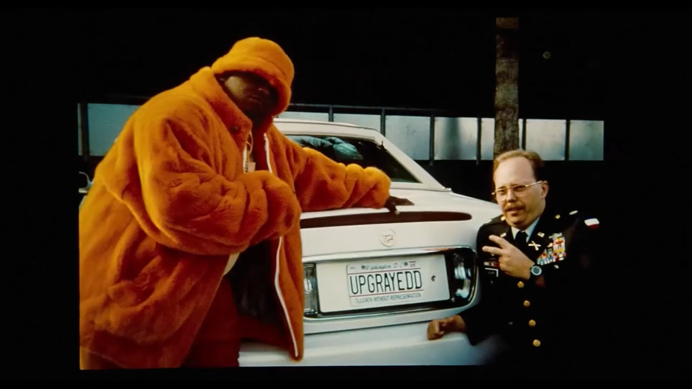

# PimpMyShell (P.M.S.)



**Exclusively for Windows 11.**

PimpMyShell dresses up the Windows 11 taskbar from the inside. It hooks the taskbar's own XAML in explorer.exe and
draws with it: under the buttons, over the blur. System meters, a hot-mic warning, notifications inside the taskbar,
a backdrop you can tune, glowing buttons.

## Get it

**[Download the Windows installer][releases]** (`pms-setup-VERSION.exe`, x64).

It installs for you alone, no administrator needed, into `%LOCALAPPDATA%\Programs\PimpMyShell`. You get a Start menu
entry for the settings, an entry in Settings > Apps, and (ticked by default) a start at sign-in.

Rather not install? The same release page has **`pms-portable-VERSION.zip`**. Unzip it anywhere and run `pmsd.exe`.
No Start menu entry, no start at sign-in (the tray menu can switch it on), and no self-updating.

The files aren't code-signed yet, so SmartScreen may warn you. Choose *More info* > *Run anyway*. Every release lists
the SHA-256 of each file in `SHA256SUMS.txt`.

[releases]: https://github.com/bungholesurfers/PimpMyShell/releases/latest

## What you get

- **Meters** by the tray, from any Windows performance counter, with math over them:
  - CPU: a bar per thread, grouped by core, split into user and kernel time.
  - GPU: a bar per engine for every GPU, labelled and colored by maker (NVDA, AMD, INTC, QCOM, MSFT), with NVIDIA's
    power state (P0, P8...) when its driver is there.
  - Memory: RAM as a pie (in use, modified, standby), and a VRAM pie per graphics card.
  - Disk and network, as bars or sparklines.
  - Your own: point a meter at any perf-counter path and write an expression, like `min(gpu, 100)` or
    `vram / vram_total`. Styles: sparkline, gauge, pie, cores, engines, bars.
  - Bars can glow by how busy they are, or by how hot they've got. Hover any meter for a tooltip.
- **Hot mic.** While an app has the microphone open, the whole taskbar warns you. Then it settles into a label naming
  the apps, with sonar rings and the mic's loudness rising in the background.
- **Toasts in the taskbar.** Notifications show inside the taskbar instead of popping up. Their buttons work. The
  card glows in the app icon's color, rings ripple across the taskbar, and the clock stays in sight.
- **Your own backdrop.** Blur, tint and grain, with knobs. One look for dark mode, one for light, following Windows.
- **Glowing buttons.** Start and every app button glow when you point at them, brighter when pressed. Each app glows
  in its icon's color.
- **Settings** that show every option by its config name, with knobs that go to eleven. Changes apply as you make
  them.
- **A tray icon** to pause, open the settings, switch start at sign-in, read the log, or exit.
- **A watchdog** that backs off if explorer ever crashes with PimpMyShell in it.
- **Signed updates**, checked every day or two if you agree (or whenever you ask), installed only when you say so.
- **Easy on the battery.** Unplugged, the hot-mic animation drops to 30 fps by default. `max_fps` caps it always.

## Using it

Your settings live in `%LOCALAPPDATA%\PimpMyShell\pms.toml`. The first run writes it from `pms.example.toml`, which
explains every option. Edit it by hand or in the settings window (left-click the tray icon). The daemon picks up
changes within a second.

The tray icon's menu:

| Item | What it does |
| --- | --- |
| Settings | opens the settings (a left click does too) |
| Pause (stock taskbar) | puts the stock taskbar and native notifications back until you resume |
| Hook explorer again | shows up only after the watchdog backed off (below) |
| Start at sign-in | the HKCU Run value, on or off |
| Check for updates | checks now; once a new version is downloaded and checked, *Install PimpMyShell X…* (asks first) |
| Open log | `daemon.log` in Notepad |
| Exit | stops the daemon, which puts the stock taskbar back |

Toasts need notification access. Windows asks the first time; it lives under Settings > Privacy & security >
Notifications.

## Is it safe? What does it change?

PimpMyShell is **unofficial**. It pokes undocumented internals of explorer.exe. A Windows update can rename or
rearrange the taskbar's insides and break it. When that happens, the worst case should be a stock taskbar: the
watchdog stops hooking explorer if it crashes with PimpMyShell inside (see below). Still, you're running code inside
your shell. Keep that in mind.

What it touches, all under your own user (no admin, no services, no drivers):

- **`HKCU\Software\Microsoft\Windows\CurrentVersion\Run`**, value `PimpMyShell`: start at sign-in. Off by unticking it
  in the tray or the installer.
- **`HKCU\Software\Classes\AppUserModelId\PimpMyShell`**: the name and logo PimpMyShell's own notifications go out
  under (the watchdog's warning, say).
- **`HKCU\Software\Microsoft\Windows\CurrentVersion\Notifications\Settings\<app>`**, value `ShowBanner`: with in-taskbar
  toasts on, each app's native popup is switched off as PimpMyShell meets it. The original value is written down in
  `banners.txt` *before* it's changed, and put back when the daemon stops, pauses, or turns toasts off. If the daemon
  crashed, the next start puts them back first.
- **`HKCU\Control Panel\NotifyIconSettings`**: on its very first start, the tray icon is promoted out of the overflow,
  once. Hide it again and it stays hidden.
- **`%LOCALAPPDATA%\PimpMyShell`**: `pms.toml`, the logs (`daemon.log` and `tap.log`, each rotated at 1 MB with two
  older generations kept, `daemon.1.log` and `daemon.2.log`; about 3 MB each at most), `banners.txt`, `tree.txt` (a
  dump of the taskbar's visual tree), `update-checked.txt` (when updates were last checked), `pms-128.png`,
  `tray-pinned.txt`, and `pms_tap-<stamp>.dll` copies (see below).
- **`%TEMP%\pms-update`**: a downloaded update, until it's installed.

It reads, but never writes, the notification database (`wpndatabase.db`), to get a toast's full content.

The only network traffic is the update check. A minute into the first run, PimpMyShell asks whether it may check
by itself; if yes, it checks every day or two (`update_check` in the config, or the settings' *software update*). You
can also check from the tray or the settings. It sends nothing but the requests themselves.

**Turning it off:** tray > *Pause* for a stock taskbar right now, tray > *Exit* to stop. `pms daemon stop` does the
same from a console.

**Uninstalling:** Settings > Apps > PimpMyShell. The uninstaller stops the daemon (stock taskbar and banners back),
removes the Run value and its Task Manager startup mark, the notification registration, `%TEMP%\pms-update`, and the
logs, `tree.txt` and `update-checked.txt` (each by its exact name). It keeps `pms.toml` (your config) and
`banners.txt` in `%LOCALAPPDATA%\PimpMyShell`. Delete that folder by hand if you want it gone. A TAP copy stays loaded, inert, in the running explorer until explorer restarts or you sign out.

## How it diddles Explorer

The Windows 11 taskbar is a system XAML (`Windows.UI.Xaml`) island hosted inside explorer.exe. PimpMyShell gets a DLL
into that process through the front door Microsoft built for Visual Studio's Live Visual Tree, and then edits the
taskbar's element tree from inside.

```
 pmsd.exe (daemon, your session)                         explorer.exe
 ├─ config, hot reload                                   └─ pms_tap.dll (the "TAP")
 ├─ PDH / DXGI / NVML sampler    \\.\pipe\pms-tap           ├─ IVisualTreeService3 (mirror of the taskbar tree)
 ├─ mic watch (consent store)  ─── length-prefixed ───▶     ├─ command interpreter on the pipe thread
 ├─ toast listener + banners      text commands             └─ XAML / Composition work on the UI thread
 ├─ watchdog (exit code, event log)
 └─ tray icon
```

### The crates

| Crate | What it is |
| --- | --- |
| `pms` | the daemon (`pmsd.exe`, windowless; `pms.exe daemon` in a console), the `pms` command line, config, sampler, watchdog, tray, updater |
| `pms-tap` | `pms_tap.dll`, the TAP loaded into explorer. Draws everything in the taskbar and serves the pipe |
| `pms-xaml` | a `windows-bindgen` projection of the slice of `Windows.UI.Xaml` it needs. windows-rs stopped shipping XAML, but its metadata still describes it |
| `pms-gui` | the settings (egui) |
| `pms-ui` | widgets the settings and the art tool share (the knobs) |
| `pms-art` | renders the icons and the installer's pictures from `art\` |
| `pms-res` | puts the icon and version info into the exes |
| `pms-recon` | step zero: dumps the HWND tree of every taskbar, to see what hosts what (system XAML vs. WinUI 3) |
| `xtask` | the build tasks |

### Getting in: `InitializeXamlDiagnosticsEx`

`Windows.UI.Xaml.dll` exports `InitializeXamlDiagnosticsEx(endpoint, pid, dll, tapDll, tapClsid, initData)`. It's the
XAML Diagnostics entry point: given a process id and a DLL, XAML in *that* process loads the DLL, creates a COM object
from it by CLSID, and hands it an `IXamlDiagnostics` site. That DLL is a TAP ("Tool/Test Attach Point").

`pms inject` (and the daemon) does this:

1. Finds explorer's pid from `Shell_TrayWnd`, but only once it has its
   `Windows.UI.Composition.DesktopWindowContentBridge` child, i.e. the XAML island exists.
2. Asks any TAP already there to `detach`.
3. Copies `pms_tap.dll` to `%LOCALAPPDATA%\PimpMyShell\pms_tap-<timestamp>.dll`. Explorer keeps every copy it loaded
   locked until it exits, so each injection gets a fresh copy. Old copies get swept up when they're no longer loaded.
4. Calls `InitializeXamlDiagnosticsEx` with that copy and the TAP's CLSID, trying endpoint names
   `VisualDiagConnection1..100` until one isn't taken.
5. Waits for the new TAP to open its pipe and answer `ping`.

### Inside: the TAP

The TAP is a plain COM object implementing `IObjectWithSite` and `IVisualTreeServiceCallback2`, exported through
`DllGetClassObject`. The XAML Diagnostics interfaces (`xamlom.h`) aren't in windows-rs, so they're hand-written in
`pms-tap/src/xamlom.rs`, vtable order and all.

- **`SetSite`** receives the site and casts it to `IVisualTreeService3` and `IXamlDiagnostics`.
- **`AdviseVisualTreeChange`** replays the whole existing tree through `OnVisualTreeChange` and then reports every
  add and remove. It must be called from another thread: called from `SetSite` (on the UI thread) it deadlocks.
- The TAP keeps a **mirror** of the tree: handle, type, name, parent, child index. Commands find elements in it by
  name or type (`BackgroundFill`, `TaskListButton:2`), and it's dumped to `tree.txt` when it changes.
- **`GetDispatcher`** gives the island's `CoreDispatcher`. Anything touching XAML is posted to the UI thread with
  `RunAsync`, waited on for at most 5 seconds, and wrapped in `catch_unwind`: a Rust panic unwinding into XAML would
  take explorer with it.
- `DllCanUnloadNow` always says no. The TAP leaves threads running, so COM must never unload it. A detached TAP calls
  `UnadviseVisualTreeChange` and goes inert.

The diagnostics API can also read the property chain (`GetPropertyValuesChain`), create objects from strings
(`CreateInstance`), and `SetProperty` / `ClearProperty` / `AddChild` / `RemoveChild`. For real drawing, the TAP gets
the live object behind a handle (`GetIInspectableFromHandle`) and uses the generated `pms-xaml` bindings like any XAML
app would.

### The layer cake

On the builds PimpMyShell was made on, the taskbar's background looks like this:

```
TaskbarFrame
└─ RootGrid
   └─ BackgroundControl
      └─ Grid
         ├─ BackgroundFill        Rectangle, Fill = the stock AcrylicBrush (blur, tint and noise in one effect)
         └─ BackgroundStroke
   (the buttons live in a later sibling, so anything in this Grid sits under them)
```

The TAP inserts its own elements into that Grid, right after `BackgroundFill`, always in this order:

```
BackgroundFill, [Backdrop host], [Alert host], [Stage canvas], [Grain host], BackgroundStroke, ...
```

- **Backdrop.** The stock `AcrylicBrush` bakes blur, tint and grain into one effect, so nothing can go in between.
  With `[backdrop]` on, the TAP parks the stock brush (keeping a strong reference, to put it back later), sets
  `BackgroundFill.Fill` to a transparent brush, and hands its own composition tree to an empty Grid with
  `ElementCompositionPreview.SetElementChildVisual`:
  - a `SpriteVisual` with a `HostBackdropBrush` (DWM's already-blurred desktop),
  - a tint `SpriteVisual`,
  - a "layer" `SpriteVisual` for washes and pulses,
  - a container that paints the free gaps between buttons (it follows layout changes),
  - and, in the Grain slot further up, tiles of noise: a 512x128 grayscale PNG generated at startup, loaded through
    `LoadedImageSurface`. The grain knob is that visual's opacity.

  DWM only feeds a host backdrop to windows that opted in, and only takes the opt-in from the process that owns the
  window. So the TAP itself sets `DWMWA_USE_HOSTBACKDROPBRUSH` on explorer's `Shell_TrayWnd` and
  `Shell_SecondaryTrayWnd` windows.
- **Alert slot.** The hot-mic alert: a `ShapeVisual` with a breathing rounded-rect wash and sonar-ring ellipses. The
  toast ripple and the button glows sit here too.
- **Stage.** A hit-test-invisible `Canvas` holding the meter strip. Above the blur and the alert, below the grain, so
  meters get grained like the rest of the taskbar.

Because the pointer never reaches the stage, meter tooltips use transparent hover zones placed in the top-level Grid
(the one holding `TaskbarFrame` and `SystemTrayFrame`), and a windowed `Popup` that can stand above the taskbar.
Toast cards go in that Grid too, over the tray. The tray fades away while one shows.

Where things fit comes from **layout tracking**: on every `LayoutUpdated` the TAP measures the children of
`TaskbarFrameRepeater` and `SystemTrayFrameGrid` and works out the free stretches. The meter strip fits itself into
the space beside the tray. When it runs short, it squeezes spacing, then graphics, then text width, then hides meters
from the end of the list.

**Glows.** The Start button (`LaunchListButton`) is a `ToggleButton`: the TAP listens to its `IsPointerOver`,
`IsPressed` and `IsChecked` (Start menu open) with `RegisterPropertyChangedCallback`. App buttons (`TaskListButton`)
take pointer events instead. Each app's color comes from rendering its icon with `RenderTargetBitmap` and picking the
most prominent hue.

**Frame pacing.** The compositor runs keyframe animations at the display's rate and has no setting for a slower one.
So `pace <fps>` samples a long-running animation into held steps, and nothing on screen changes between them.

### The pipe

The TAP serves `\\.\pipe\pms-tap`:

- one instance at a time (`FILE_FLAG_FIRST_PIPE_INSTANCE`, so a stale TAP can't share it), remote clients rejected,
- a DACL of SYSTEM and the owner only,
- each request and each response a frame: a little-endian `u32` length, then UTF-8 text,
- a request is a command line: `status`, `reset`, `backdrop tint #7F060606`, `meters push ...`, `toast show ...`.
  `batch "<cmd>" "<cmd>" ...` runs several in one UI-thread job, one layout pass.

The daemon opens a fresh connection per request, so nothing hogs the single instance. `pms` with no arguments is a
REPL against the same pipe, and `pms help` lists the commands, including raw tree surgery like
`pms props BackgroundFill/Fill` and `pms set <elem> <Prop> <value>`.

### The daemon's loop

`pmsd.exe` holds a single-instance mutex and sleeps in `WaitForMultipleObjects` on a stop event, the mic watcher's
registry event and the tray's event, waking for whichever is due: meter intervals, mic levels, toast polls. Once a
second it reconciles:

1. **`status`.** The TAP answers `tap=<copy id> taskbar=<BackgroundFill handle> backdrop=.. alert=.. meters=N
   toast=..`. The UI-thread hop doubles as a liveness check.
   - No pipe at all (first run, explorer restarted): **inject**, once the taskbar's island exists, at most every
     5 seconds.
   - Three failed exchanges with a TAP that's there: replace it.
   - A TAP copy or taskbar tree it hasn't configured, or one that drifted from the config (someone ran `reset`):
     **`reset`**, then apply the whole config again.
2. **Config hot reload.** When `pms.toml`'s modified time changes, it's loaded and validated. Only the sections that
   changed are re-sent, in one batch, so saving from the settings doesn't flash the taskbar back to stock. A broken
   file keeps the previous config.
3. **Theme and power.** It follows `SystemUsesLightTheme` (with `theme = "auto"`) and switches between the dark and
   light looks. On battery (`GetSystemPowerStatus`) it lowers the animation cap.
4. Then the hot mic, toasts and meters (below).

Exit, `pms daemon stop`, or Ctrl+C sends `reset` (stock taskbar) and restores the banners. The TAP stays loaded,
inert, until the next daemon.

### Where the meter numbers come from

- **PDH.** Counters are added with `PdhAddEnglishCounterW`, so configs use English paths whatever the display
  language. Wildcard instances (`\Network Interface(*)\Bytes Received/sec`) are aggregated with `sum`, `max`, `min`,
  `avg`, or `engine` (per-engine sum, then the busiest engine, the way Task Manager computes GPU %), skipping `_Total`.
  Meters that share an interval share a PDH query, collected only when that interval comes round. `typeperf -q`
  lists the paths.
- **Expressions.** A tiny parser: `+ - * /`, parentheses, `min`, `max`, `abs`, over counter names and builtins
  (`ram_total`, `vram_total`, `swap_total`, `swap_used`, `cpu_count`).
- **CPU threads.** Per-CPU busy time from `QueryIdleProcessorCycleTimeEx` against the TSC. The user/privileged time
  counters only move in whole timer ticks, so they just decide the user/kernel split. Grouping comes from the CPU topology
  Windows reports.
- **GPUs.** DXGI enumerates the adapters (software ones like WARP left out unless asked). `per_gpu = true` turns one
  meter into a pie per adapter with dedicated memory, reading `\GPU Adapter Memory(luid_..._phys_*)\Dedicated Usage`
  against the adapter's size. The maker comes from the adapter's name.
- **NVML.** If NVIDIA's driver is installed, `nvml.dll` is loaded at runtime for each GPU's performance state. No
  NVIDIA, no NVML, no problem.

### Hot mic

The same source as Windows' own mic indicator: the capability consent store,
`HKCU\...\CapabilityAccessManager\ConsentStore\microphone`. Every app that ever used the mic has a key there (packaged
apps by family name, others under `NonPackaged` by path) with `LastUsedTimeStart` and `LastUsedTimeStop`. While an app
holds the mic, `LastUsedTimeStop` is 0. `RegNotifyChangeKeyValue` wakes the daemon on any change, so the warning
shows up at once.

App names come from the exe's `FileDescription` or the package's display name. While the mic is hot, the daemon reads
every active capture endpoint's `IAudioMeterInformation` peak about 15 times a second, plus the default endpoint's mute,
and feeds them to the alert. Apps that mute themselves (Discord, Teams) still read as live: Windows can't see that.

### Toasts

- **Source.** `UserNotificationListener` works unpackaged once you allow notification access. Its change event needs
  package identity, so the daemon polls it twice a second. The listener only exposes text, so the full toast XML
  (images, buttons, launch arguments) is read from the notification platform's `wpndatabase.db` by the same id,
  read-only.
- **Native banners out of the way.** `ShowBanner=0` under an app's `Notifications\Settings\<AUMID>` key takes effect
  live: the notification still reaches the center (and the listener), but the popup is gone. The daemon sets it per
  app as it meets them and restores it all as described above. An app's very first notification predates its key, so
  that one still pops up natively.
- **Clicks** on the card are queued in the TAP; the daemon collects them and activates the app the way Windows would:
  its `INotificationActivationCallback` COM activator, a protocol URI, or launching the app.
- Do not disturb and full-screen apps still hold toasts back (`SHQueryUserNotificationState`).

### The watchdog

PimpMyShell never brings back an explorer that was simply ended: Task Manager and `taskkill` leave exit code 1, and
people do that on purpose. A **crash** is another matter. The daemon holds a handle to the explorer it hooked:

1. Explorer exits with an exception code (`0xC...`, at least `0x80000000`): a crash.
2. The daemon looks up the matching **Application Error, event 1000** record in the Application log (same app, same
   pid) and reads the faulting module.
   - `pms_tap*`, or XAML / composition modules the TAP drives (`Windows.UI.Xaml.dll`, `dcomp.dll`,
     `CoreMessaging.dll`, ...): bench at once.
   - Anything else: once is explorer's own business. Twice within 10 minutes: bench.
3. Hooking that keeps failing benches too: 3 failed injections in a row, or a TAP replaced more than 3 times in the
   same explorer.
4. Windows normally restarts a crashed shell. If it hasn't within 12 seconds, the daemon starts explorer.exe, but only
   after a crash, never after it was ended.

**Benched** means: `reset` to the stock taskbar, native banners restored, the TAP told to `detach`, and no more
hooking for the rest of this run. You get a notification saying why, and the tray menu offers *Hook explorer again*,
which forgets the strikes and starts over.

### The updater

Nothing installs without you saying so.

- **When.** A minute into the first run, the daemon asks whether it may check by itself. If yes, it checks a while
  after each start (1 to 30 minutes, at random) and then every 24 to 48 hours (2 to 6 after a failed check). The time
  of the last check is kept, so signing in again doesn't check again. *Check for updates* in the tray menu and the
  settings' *software update* checks right away.
- **Telling you.** A new version is downloaded and checked, then a notification says it's ready and the tray menu
  offers *Install PimpMyShell X…*, which asks first. The settings show it too, with *Install X and restart*.
- **What's new.** The *stable* channel (`update_channel = "stable"`, the default) reads a tag from `update/stable.txt`
  on the repo's main branch. The *latest* channel takes the newest release, its tag read off where GitHub's
  `/releases/latest` redirects (a HEAD request). Only a version newer than the running one counts, except for the
  settings' *Reinstall stable* and *Reinstall latest release*, which fetch that version whatever this one is (still
  only as its signed manifest describes it, and still asking before installing).
- **Signed manifest.** Each release carries `pms-update.json` (version, installer name, size, SHA-256) and
  `pms-update.json.sig`, an Ed25519 signature over the manifest's exact bytes. The updater believes the manifest only
  if a public key compiled into `pms/src/signing.rs` verifies it (`verify_strict`), it names the very version asked
  for, and the installer is named `pms-setup-<version>.exe`. The tag itself is unsigned: at worst it can hold updates
  back.
- **Download.** Into `%TEMP%\pms-update`, size capped, hashed while it streams. Kept only if the size and SHA-256
  match the manifest. Hashed once more right before it runs, since it sat in `%TEMP%` meanwhile, and held open
  against writing from that hash until the installer has started.
- **Network.** HTTPS only, to GitHub's hosts only (`github.com`, `raw.githubusercontent.com`,
  `objects.githubusercontent.com`, `release-assets.githubusercontent.com`). Redirects are followed by hand and each one
  is checked the same way: no other host, no user, no port. TLS against Mozilla's roots, bundled. Timeouts and a size
  cap on every response.
- **Install.** The Inno Setup installer runs `/VERYSILENT /SUPPRESSMSGBOXES /NORESTART`. It stops the daemon, installs
  over it, and starts it again. The version goes into `tried.txt` first: if the install didn't take, the next check
  by itself says so instead of looping (one you ask for tries again).
- Only an installed copy (running from `%LOCALAPPDATA%\Programs\PimpMyShell`) updates itself. A portable or dev build
  just says whether a newer release is out.

## Building from source

You need Rust via rustup. `rust-toolchain.toml` pins the compiler (1.99.1, with clippy and llvm-tools); `rustup
install` in the checkout fetches it. The pin matters because a PGO profile only fits the compiler that recorded it.

Everything runs through `cargo xtask` (an alias in `.cargo/config.toml`):

```
cargo xtask build        release build of pmsd.exe, pms.exe, pms-gui.exe and pms_tap.dll into target\release
cargo xtask check        clippy with warnings as errors, then every test
cargo xtask installer    build, then pack target\installer\pms-setup-VERSION.exe with Inno Setup 6
                         (--no-build packs what's built, --pgo packs the PGO build, --install installs it silently)
cargo xtask art          render the icons and the installer's pictures from art\ (the results are checked in)
cargo xtask pgo [SECS]   profile-guided build: instrument, train on this very taskbar (default 60 s), merge, build
cargo xtask help         the full list, including the separate pgo-* steps
```

Everyday builds skip LTO entirely, so a change rebuilds in seconds. Only the PGO build takes fat LTO.

The installer needs **Inno Setup 6**: `winget install --id JRSoftware.InnoSetup --scope user`. VERSION is the
workspace's version, in the root `Cargo.toml` (`[workspace.package]`), which every crate takes.

To try a fresh TAP by hand: stop the daemon first (`pms daemon stop`), then `pms inject`, then poke it with `pms`.
Two TAPs racing for one pipe is no fun.

`installer\INSTALLER.md` has the rest: the release key, signing a release, the update process.

## Credits

The crab is [**Red Crab** by Scout](https://openclipart.org/detail/192996/red-crab), Openclipart 192996, public domain
(CC0 1.0). See `art\openclipart-192996\SOURCE.txt`. The logo adds a dollar to it, rendered by `pms-art`.

## License

MIT: see [LICENSE](LICENSE). The crab art is CC0 (public domain), see above.
