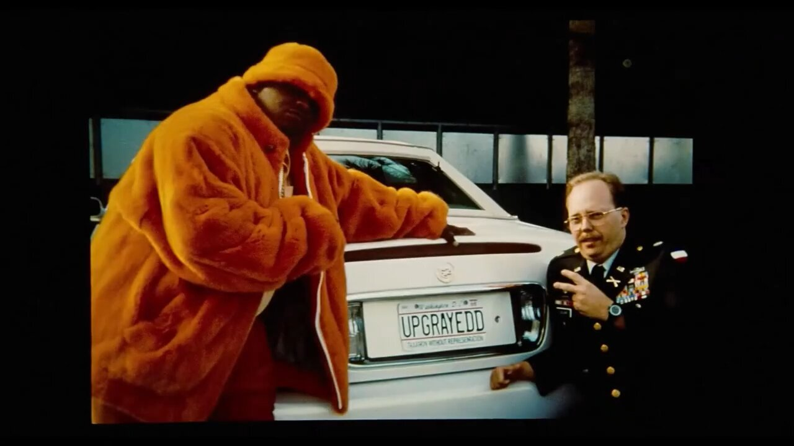
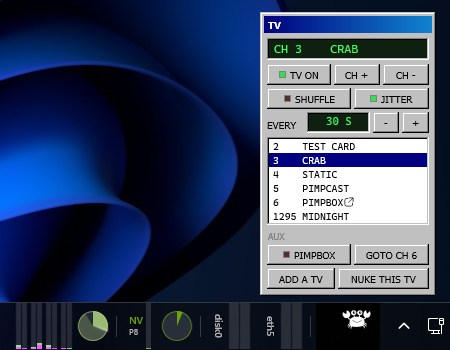

# PimpMyShell (P.M.S.)



**Exclusively for Windows 11.**

PimpMyShell dresses up the Windows 11 taskbar from the inside. It hooks the taskbar's own XAML in explorer.exe and
draws with it: under the buttons, over the blur. System meters, a hot-mic warning, notifications inside the taskbar,
a backdrop you can tune, glowing buttons.



## Get it

**[Download the Windows installer][releases]** (`pms-setup-VERSION.exe`, x64).

It installs for you alone, no administrator needed, into `%LOCALAPPDATA%\Programs\PimpMyShell`. You get a Start menu
entry for the settings, an entry in Settings > Apps, and (ticked by default) a start at sign-in.

Rather not install? The same release page has **`pms-portable-VERSION.zip`**. Unzip it anywhere and run `pmsd.exe`.
No Start menu entry, no start at sign-in (the tray menu can switch it on), and no self-updating.

The files aren't code-signed yet, so SmartScreen may warn you. Choose *More info* > *Run anyway*. Every release lists
the SHA-256 of each file in `SHA256SUMS.txt`.

[releases]: https://github.com/bungholesurfers/PimpMyShell/releases/latest
[issues]: https://github.com/bungholesurfers/PimpMyShell/issues

## What it works with

The taskbar that comes with Windows 11, and that's the whole list. PimpMyShell draws inside that taskbar's own XAML, so
it needs the real thing to be there.

- **A 64-bit Intel or AMD PC.** Not Windows on Arm yet: Explorer there can't load the part of PimpMyShell that goes
  inside it, so the installer says no instead of installing something that would do nothing.
- **One screen** is what it's been tried on. With several, it dresses one taskbar, and we haven't yet been able to
  check that it's always the main screen's. If it picks the wrong one for you, [tell us][issues].
- **Taskbar replacements** can't work with it: ExplorerPatcher or StartAllBack with their classic taskbar on, Start11's
  taskbar, or a bar of its own like RetroBar, Cairo or Seelen UI. There's nothing to hook, and nothing we can do about
  that. PimpMyShell tells you so once and lays low. Switch back to the Windows 11 taskbar and it picks up by itself.
- **Those same tools with their taskbar off**, used for a Start menu, say, are fine.
- **Mods of the Windows 11 taskbar**, like Windhawk's or TranslucentTB, often get along with it, but they hook the same
  thing we do. If something's off, try without them. We can't promise this one either.

## What you get

- **Meters** by the tray, from any Windows performance counter, with math over them:
  - CPU: a bar per thread, grouped by core, split into kernel time (at the bottom) and user time above it.
  - GPU: a bar per engine for every GPU, labelled and colored by maker (NV, RAD, INTC, QCOM, MSFT), with NVIDIA's
    power state (P0, P8...) when its driver is there.
  - Memory: RAM as a pie (in use, modified, standby), a VRAM pie per graphics card, and the pagefile only once RAM
    runs short.
  - Disk and network: write/read and up/down bars per disk and per interface. The disk Windows is on and the
    interface your internet goes through always show, first; the others join while busy, then fall off.
  - Your own: point a meter at any perf-counter path and write an expression, like `min(gpu, 100)` or
    `vram / vram_total`. Styles: history (a sparkline), bar (a gauge), pie, cores, engines, bars, disks, nics.
  - Bars can glow by how busy they are, or by how hot they've got. Hover any meter, or any GPU, disk or interface
    in one, for a tooltip that says what it is and what it's doing.
- **Hot mic.** While an app has the microphone open, the whole taskbar warns you. Then it settles into a label naming
  the apps, with sonar rings and the mic's loudness rising in the background: beside the tray, or first, before your
  meters and TVs, if you'd rather.
- **Your order.** Your meters, together, and each TV and Twatch TV go along the taskbar in the order you give them on
  Settings > Widgets, with the mic's label at whichever end you like.
- **Toasts in the taskbar.** Notifications show inside the taskbar instead of popping up. Their buttons work. The
  card glows in the app icon's color, rings ripple across the taskbar, and the clock stays in sight. New ones stack
  on top of the ones still showing, and you can flick a card off to the right to dismiss it. They stay as long as
  Windows would keep them: alarms, calls and reminders wait for your answer. Set `style = "pimped"` under `[toasts]`
  for gold cards with a sheen.
- **Your own backdrop.** Blur, tint and grain, with knobs. One look for dark mode, one for light, following Windows.
- **Glowing buttons.** Start and every app button glow when you point at them, brighter when pressed. Each app glows
  in its icon's color.
- **Settings** that show every option by its config name, with knobs that go to eleven. Changes apply as you make
  them.
- **A tray icon** to pause, open the settings, switch start at sign-in, read the log, or exit.
- **A watchdog** that backs off if explorer ever crashes with PimpMyShell in it.
- **Signed updates**, checked every day or two if you agree (or whenever you ask), installed only when you say so.
- **Out of the way when it can't be seen.** While a window fills the screen your taskbar's on, a game or a video, your TVs
  stop drawing, the PIMPBOX rests, and Twatch TVs with their sound off stop: from about a quarter of a CPU thread to a few percent,
  back the moment the taskbar is. While a game's on (it fills the screen, keeps your graphics card busy, and somebody's
  playing, keyboard, mouse or controller), Twatch TVs make way too, and the PIMPBOX stops unless you've been playing it. Both are
  on Settings > Power & performance.
- **Easy on the battery.** Unplugged, the hot-mic animation drops to 30 fps by default. `max_fps` caps it always.

## A TV in your taskbar

The last thing on the strip is a `screen`: a little TV, on by default, in the spirit of WindowMaker's dockapps. Point at it for
its remote: channel up and down, shuffle, and power. Shuffling TVs change channel every 30 seconds, or however often you set on any
remote or in Settings, which is for all of them. With jitter on, each is late by its own random amount, up to a quarter of that;
with it off, they all change together. Add as many sets as you like in Settings > TV, and move them along the taskbar on
Settings > Widgets.

On starting, each set flips up through its channels, from Captain Midnight's 1295 round to channel 304, and stays there. Settings > TV
changes where it starts and stops, or turns that off.

| Channel | |
|---|---|
| 2 | The test card |
| 3 | The crab, bouncing around and changing color, as a DVD player's logo does when it's left alone |
| 4 | Static |
| 5 | The PimpCast, a local-weather channel of the sort cable boxes had: it's always going to rain |
| 37 | Number One: the International Space Station's urine tank, live, below |
| 304 | The PIMPBOX: a game console plugged into your TVs. POOM (room) plays Doom's games on it |
| 1295 | [Captain Midnight](https://en.wikipedia.org/wiki/Captain_Midnight_broadcast_signal_intrusion), who took over HBO's satellite feed in April 1986 over the price of scrambling |

Give the console a game on Settings > PIMPBOX and it's on channel 304. (It was on 6 until 0.1.8; a TV left there, and Settings
> TV's run through the channels, are moved for you.) It comes on with a boot animation of its own, and then
the demos play in the taskbar. Click the picture to stop shuffling, then again to pop its display out into a window and play: W,
A, S and D or the arrows to move, the mouse to turn and shoot, E or space to open doors. The window has the keys and the mouse
only while there's a game to play, and Ctrl+Alt+G lets go of them. It stays when a game ends (the console comes back on by
itself, with a shorter animation, and plays it again) and when the console's switched off, and it has the TV's remote and the
console's own little settings window beside it. The console keeps running when you change the channel, as a console does, and
has a power button of its own. With nobody watching, it rests.

The console's settings window, beside the remote, chooses which game it plays and how big a picture it puts out: 480p, which is
what nearly everything of its day used, or 720p, when the taskbar's set goes wide to match. Settings > PIMPBOX has 1080i too.
Settings > PIMPBOX fetches [Freedoom](https://freedoom.github.io/) or the Doom shareware episode, on request, or you can add
your own IWAD. No game data comes with PimpMyShell. Sound is off, and no audio device is opened.

On battery a TV you leave alone sleeps, holding its last picture and sending nothing, and wakes for 30 seconds when you touch it.
A sleeping TV costs what no TV does. On mains it runs at 60 frames a second, 30 while the machine stays busy, for a few percent of
one CPU thread in Explorer.

Turned off, any set stays for seven seconds, then shrinks to a small button: click it to turn the set back on.

### Number One

Channel 37 is the ISS's urine tank. An astronaut has planted his flag on the moon, Earth over his shoulder, and the flag is the
tank: pee-yellow from the hem up to the level, the number big across it, with PTV's logo in the corner. Bubbles while the urine
processor is distilling it, an amber light when it's nearly full, grey with LOS while the station's between ground stations, and
a whirlpool and FLUSH! when it's been emptied. The flag ripples when a new value comes in; otherwise it holds still, as it costs
the taskbar nothing that way. Click the picture for the station's other water, the waste water and the drinking water, five
seconds each. The remote has the rest beside it: what the processor's doing and for how long, and when it last heard.

The numbers are NASA's own ISSLive! telemetry, by way of [Lightstreamer](https://lightstreamer.com/), and the idea is [pISSStream](https://github.com/Jaennaet/pISSStream)'s, by Jaennaet
(none of its code). It's off until you switch it on in Settings > TV, as it goes online for them, in the background, through the
proxy if you say so on Settings > Network. How often follows the tank: it fills for most of a day and then drains for a few
hours, a percent every five minutes or so, so it looks every 15 minutes while it fills, more often as it drains, and live (each
change as it comes) for the last few minutes, to catch the flush as it happens. Half as often while you're away or on battery.
Each look is one request: about 100 to 150 a day. A notification tells you when the station flushes, unless you switch it off.

Now and then PTV, the channel, plays a bump in place of the tank: a few seconds of software-rendered 3D, as a channel's idents
were in 1985. Seven idents (the P tumbling in, lifting off its pad, going down the toilet, built from blocks over a neon grid,
changing skins, falling on the astronaut, sprayed through a stencil onto the station's urine tank) on the quarter hour, and four
homages to a video of the day (a showroom of TVs, a spacewalk, a throne, a throne in orbit) on the hour; one when you're back
after ten minutes away, and one on a toilet when the station flushes. Only while you'd see them, and never on battery.
Settings > TV makes them hourly or turns them off; PLAY A PTV BUMP on the remote, or `pms bump [name]`, plays one now.

### Twatch TV

A Twatch TV is a 16:9 flat-screen set that keeps an eye on your favorite Twitch channels, in the order you put them, and plays the
best one that's live as live video in the taskbar. It's off until you turn it on in Settings > Twatch TV, and there's no sign-in,
API key or client ID. Pointing at the set brings up its remote: what's on and how well it's playing, power, sound (off to begin
with), channel up and down, and your favorites, live ones lit. Clicking the picture opens the channel.

- Your favorites live beside your settings, in `pms-twatch-watchlist.txt`: one channel per line, best first, as names, @names or
  twitch.tv links, with `#` for comments. A line that can't be a channel is skipped and pointed out, and the rest carry on.
- Finding out who's live is one small request for a channel's preview picture on Twitch's CDN. Every favorite gets one about
  every 10 minutes, plus a random wait of up to 5 minutes picked afresh each time, whatever its place in the list. They go in no
  order, one at random of those due, spread out so that no two come together, and nobody's looked at again before their wait is
  up. At the start, those never looked at go a few seconds apart, so the sets know who's live within moments. Settings can change
  both, and it's all twice as long on battery.
- Each set follows your favorites, stays on its channel until that ends, or only ever shows one channel, with no signal until it's
  live. Its remote has a key for each, and says what'll happen, in so many words: "Switches if crab goes live", or "Only ever shows
  crab: no signal until they're live". Settings says what sets do by default. Picking a channel from the remote stays on it until
  it ends; on a set kept to one channel, it changes which. The remote also sets the highest quality, for every set.
- With more favorites live than sets, more sets come by themselves, three unless Settings says otherwise, and go when those streams
  end. An A beside them says that's on, and selecting it switches it off; dim, it stays there to switch it back on. With no more to
  come, a purple plus beside the sets says there are favorites left over, and adds a set for good.
- A notification says when a favorite goes live, unless you turn that off.
- Pictures can stand in for video, only when RAM or VRAM is low (the usual), until you click a set, always, or never. Pictures need
  no Streamlink, and show on battery whatever you've chosen.
- Live video needs [Streamlink](https://streamlink.github.io/), which Settings downloads on request from the project's
  [Windows builds](https://github.com/streamlink/windows-builds): the newest stable release, taken only if GitHub says its own
  runners uploaded it, and only if it hashes to the digest GitHub keeps for it. That proves it's the file the project published,
  not that it's safe, so nothing newer is ever installed unasked. Streamlink reads Twitch's website, which changes without
  warning, so if it can't open a channel that's live, PimpMyShell asks GitHub whether there's a newer release, at most every six
  hours, and tells you: getting it is your call, in Settings. Prefer no extra program? Turn on pictures, and the set shows a still
  every minute instead.
- Off the mains, a set shows a new picture every minute instead of video, and goes back to video when you plug in.
- It plays up to 480p by default, and up to 1080p60 if you ask. While your PC stays busy, or the stream keeps stalling, it steps down, a very small light
  shows on the set, and the remote says why. The network can lower it too, by itself.
- As more favorites go live and their streams start, more sets appear, and go away afterwards: up to three, unless you say otherwise (none to nine).
- When a stream has a problem, the set shows No Signal and keeps trying.
- Each set starts with a second of its logo.
- When Windows turns the display off, muted sets stop streaming and keep their last picture, and pick up again a few seconds after
  it's back. A set with its sound on keeps playing, as sound only. The console carries on as it was.
- When memory runs low (90% of RAM in use or committed) or video memory does (69% of a card's own), the players are evicted, and
  each set says so, under a very sad little TV. With RAM low the console goes too, unless it's been played since it last started:
  closing that could lose a game, so it stays until it's restarted, and a notification says so. It doesn't use the GPU, so VRAM is
  nothing to it. Everything comes back by itself once things have been fine for a minute.

Windows can't take a DLL back out of a running process, so each new build Explorer meets stays in it until Explorer restarts. Once
it has at least 10 of them and 300 MB of memory, a notification says so, and Settings can turn that off. Explorer never restarts
by itself. Asked to, from that notification, from Settings or with `pms restart-explorer`, it won't with a folder window, file copy
or Explorer dialog open in the taskbar's process. It asks Explorer to leave, the way Exit Explorer does, and your taskbar is back
in a few seconds.

The player is `pms-twatch.exe`, its own process, using Windows' own media stack. The video never touches a window: frames are
scaled down on the GPU and handed over in shared memory, like the console's.

The console is `pms-pimpbox.exe`, its own process, so a crash can't touch your taskbar. What plays Doom's games on it is POOM:
the engine from [room](https://github.com/sunsided/room), in `pms-poom.exe`, a program of its own that the console starts, so
that the console and its window outlive a game that ends or falls over (when it falls over, the console says so, and why goes
in the log). It has no window, and sandboxed it runs without any way to make one, or to draw. So it's under the GPL version 2, unlike the rest of PimpMyShell: its source is in [`pms-pimpbox`](pms-pimpbox), and
it shares nothing with the MIT parts but frames in shared memory (`pms-screen`). Its boot animation
([`pms-pimpbox/boot`](pms-pimpbox/boot), MIT) is drawn by the graphics card with Direct3D 11, from arithmetic alone: there's no
picture, model or font file in it. Its one shader is compiled the first time and kept, and Settings > PIMPBOX can clear it.

Switch on speed demos (Settings > PIMPBOX) and, when nobody's playing, the console shows real speedruns of its game from the
[Doom Speed Demo Archive](https://dsdarchive.com) in place of the game's own demos. Each is played here first, unseen, in the
game's sandbox, and shown only if it leaves its level at the very tic the archive says it did: a demo goes out of step on a map
that isn't quite the one it was recorded on, and that one's never shown. A check takes about a tenth of a second. How much the
archive is asked of, and when, is up to you: whenever PimpMyShell runs or only while the console's on, how many hours between
looks, how many demos a look, how many seconds between downloads, how many demos a game in all, and how often its list is
asked for. By default, a look every six hours, ten demos at most, five seconds apart, forty in all.

## Using it

Your settings live in `%APPDATA%\PimpMyShell\pms.toml`, in the roaming profile, so they follow you to another PC. It holds
only what you've changed; everything else comes from the defaults, so better defaults still reach you with an update.
`pms.example.toml` is those defaults, and explains every option. Edit it by hand or in the settings window (left-click
the tray icon). The daemon picks up changes within a second. (Before 0.1.3 it lived in `%LOCALAPPDATA%\PimpMyShell`; one
there moves over by itself the first time. Before 0.1.4 it held every setting: the first run keeps only what differs from
every default we've shipped, and the whole file stays beside it as `pms.toml.full.bak`.)

The settings window is a WinUI 3 one (the Settings app's look: a pane of pages and a card per setting, over acrylic with dollar bills and sound investment advice drifting through the pane and blurred behind the settings, which, per the General page, is not investment advice) wherever the
PC has Microsoft's Windows App Runtime, which many PCs have from Store apps; PimpMyShell doesn't install it. Without it,
the same `pms-gui.exe` shows the classic (egui) window, which edits the same settings the same way; `pms-gui --egui`
asks for that one anyway, and each window has a button that opens the other. PimpMyShell's questions (software update's,
a notice's explanation, *Install X*) come as small windows of the same look where it can, else as task dialogs.

A first run on a new config opens a short welcome: how notifications should look, whether to ask before they open
anything, updates, and starting at sign-in. The General page has it again. Every part of the settings has a Reset, with a
confirmation, in both windows. A reset leaves your own decisions alone, and says which: whether to check for updates,
taskbar notifications being off, Ask before opening, and the lists of apps you've excluded.

The tray icon's menu:

| Item | What it does |
| --- | --- |
| Settings | opens the settings (a left click does too) |
| Pause | puts the standard taskbar and notifications back until you resume |
| Try again | in Pause's place, only after [the watchdog](ARCHITECTURE.md#the-watchdog) backed off |
| Start when I sign in | the HKCU Run value, on or off |
| Check for updates | checks now; once a new version is downloaded and checked, *Install PimpMyShell X…* (asks first); a portable copy offers *PimpMyShell X is available…*, which opens its page |
| Open log | `daemon.log` in Notepad |
| Save a report | saves `pms-report.txt` beside the logs, shows it, and offers to open GitHub (issues there are public) |
| Exit | stops the daemon, which puts the standard taskbar back |

Toasts need notification access. Windows asks the first time; it lives under Settings > Privacy & security >
Notifications. While it's off, notifications stay Windows', and a card of PimpMyShell's own in the taskbar says so
every 5 minutes; click it for the fix. They come to the taskbar within seconds of turning it on. Or click *Keep
Windows notifications* there: the taskbar's toasts go off (`enabled = false` under `[toasts]`; the settings' Notifications
page turns them on again), and so does the reminder.

The same kind of card tells you of the few other troubles that need you: a `pms.toml` that didn't load (click it for
the line and what's wrong with it, and a button that opens the file), or toasts that couldn't start. With toasts off
in the config, or a stock taskbar, a Windows notification says it instead.

## Is it safe? What does it change?

PimpMyShell is **unofficial**. It pokes undocumented internals of explorer.exe. A Windows update can rename or
rearrange the taskbar's insides and break it. When that happens, the worst case should be a stock taskbar: the
[watchdog](ARCHITECTURE.md#the-watchdog) stops hooking explorer if it crashes with PimpMyShell inside. Still, you're running code inside
your shell. Keep that in mind.

What it touches, all under your own user (no admin, no services, no drivers):

- **`HKCU\Software\Microsoft\Windows\CurrentVersion\Run`**, value `PimpMyShell`: start at sign-in. Off by unticking it
  in the tray or the installer.
- **`HKCU\Software\Classes\AppUserModelId\PimpMyShell`**: the name and logo PimpMyShell's own notifications go out
  under (the watchdog's warning, say).
- **`HKCU\Software\Microsoft\Windows\CurrentVersion\Notifications\Settings\<app>`**, value `ShowBanner`: with in-taskbar
  toasts on, the native popup of every app that can notify is switched off. The original value is written down in
  `banners.txt` *before* it's changed, and put back when the daemon stops, pauses, or turns toasts off. If the daemon
  crashed, the next start puts them back first. For an app that had never notified there was no key: PimpMyShell
  creates it, and deletes it again only if it's still exactly as left (no values, no subkeys). Once the app has
  notified, Windows has filled the key in and it stays, as it would have anyway.
- **`HKCU\Control Panel\NotifyIconSettings`**: on the first start of each copy (each exe path), the tray icon is
  promoted out of the overflow, once (`tray-pinned.txt` remembers). Hide it again and it stays hidden.
- **`%APPDATA%\PimpMyShell`**: `pms.toml`, `pms.toml.bak` (the settings window's copy of it from before its first save),
  `pms.toml.full.bak` (the whole file, from before it held only your changes), `pms.toml.last-good` (the last settings that
  loaded), `pms-twatch-watchlist.txt` (your Twatch TV favorites), `pms-network.toml` (a proxy, and what goes through it),
  `tv.txt` and `twatch.txt` (each TV's channel, power and sound, as you left them: they go with the sets named in `pms.toml`).
  Your favorites and network settings are kept out of `pms.toml` so that you can share it for help without them. A setting in
  `pms.toml` that can't be used (misspelled, one an older version knew, or a value that isn't one of the choices, is out of
  range, isn't a color or is the wrong kind) goes back to its default, or is left out, and the rest loads. A notification says
  so, and Settings marks each in red, with its page.
- **`%LOCALAPPDATA%\PimpMyShell`**: this PC's own files: `logs` (`daemon.log` and `tap.log`, each line timed in UTC, as
  `2026-11-09T18:21:33.512Z`, which says nothing of where you are; Settings > Logs lists what else they can say about you.
  Each is rotated at 1 MB with two
  older generations kept, `daemon.1.log` and `daemon.2.log`; about 3 MB each at most. They're here, not in the roaming
  profile, as they're about this PC and written all the time: where the roaming folder is redirected to a network share,
  each line from inside Explorer would be a network write), `banners.txt`, `tree.txt` (a
  dump of the taskbar's visual tree), `update-checked.txt` (when updates were last checked), `taskbar-told.txt` (whose
  replaced taskbar we've explained, so that it's only once), `welcomed.txt` (the welcome has been offered), `pms-128.png`,
  `tray-pinned.txt`, `seashell-carried-over.txt` (SeaShell's settings have been brought over once, and never come back),
  `vidya` (games, each in a folder of its own: `vidya\poom` is POOM's, with its games in `wads` and its settings and
  saved games, and `vidya\pimpbox\shaders` is the console's compiled shader), `streamlink`, and `tap\pms_tap-<stamp>.dll` (the TAP as Explorer loads it: see [Getting in](ARCHITECTURE.md#getting-in-initializexamldiagnosticsex)).
- **`%TEMP%\pms-update`**: a downloaded update, until it's installed.

It reads, but never writes, the notification database (`wpndatabase.db`), to get a toast's full content.

Settings > Network lists everything PimpMyShell uses the network for, with what goes where: update checks; downloads you ask
for (games, and Streamlink); and, with a Twatch TV, who's live, Streamlink finding streams, and the video itself. It sends
nothing but the requests themselves: no account, no analytics. Update checks wait for your answer: a minute into the first run,
PimpMyShell asks whether it may check by itself. *Check automatically* lets it check a while after each start and then every day
or two, *Don't check* turns that off, and closing the question answers nothing, so it asks again at the next start
(`update_check` in the config, or the settings' *software update*, changes it later). You can also check from the tray or the
settings. A check starts by reading `https://raw.githubusercontent.com/bungholesurfers/PimpMyShell/main/update/stable.txt` (on
the latest channel, `https://github.com/bungholesurfers/PimpMyShell/releases/latest`), and goes on to the release only when that
names a newer version.

Any of it can go through a SOCKS5 proxy (`socks5h://` looks names up there too), each use switched on or off, Streamlink and the
video included: Streamlink is told to use it, and the video is fetched by PimpMyShell itself, through the proxy, instead of by
Windows. Finding a stream and playing it always go the same way, as Twitch's address for a stream names the IP address that asked.
For Tor, each use can go with a random user name and password of its own, for stream isolation. What's switched on never goes
without the proxy: if it can't be reached, that fails, and if `pms-network.toml` won't load, nothing goes online until it's fixed,
and a notification says so. Nothing is airtight, least of all software PimpMyShell gets for you from elsewhere, like Streamlink:
if it matters, Windows Firewall or another filter on the Windows Filtering Platform can keep `pmsd.exe`, `pms-gui.exe`,
`pms-twatch.exe` and Streamlink to your proxy. Streamlink runs as the `python.exe` that comes with it, in PimpMyShell's
`streamlink` folder, not as its `streamlink.exe`.

**Turning it off:** tray > *Pause* for a stock taskbar right now, tray > *Exit* to stop. `pms daemon stop` does the
same from a console.

**Uninstalling:** Settings > Apps > PimpMyShell. The uninstaller stops the daemon (stock taskbar and banners back),
removes the Run value and its Task Manager startup mark, the notification registration, `%TEMP%\pms-update`, and the
logs, `tree.txt`, `update-checked.txt` and `taskbar-told.txt` (each by its exact name). It keeps `pms.toml` (your config, in
`%APPDATA%\PimpMyShell`), and `banners.txt` in `%LOCALAPPDATA%\PimpMyShell`, along with small leftovers (`pms-128.png`,
`tray-pinned.txt`, the `tap` folder). Delete those folders by hand if you want them gone. A TAP stays loaded, inert, in the running explorer until explorer restarts or you sign out: it's a hard link to the installed DLL, not a copy, so it takes no room and no writing, and it lets an update replace that DLL while Explorer still has it open.

## How it works

The Windows 11 taskbar is a system XAML (`Windows.UI.Xaml`) island hosted inside explorer.exe. PimpMyShell gets a DLL (the
"TAP") into that process through the front door Microsoft built for Visual Studio's Live Visual Tree, and edits the
taskbar's element tree from inside. A daemon in your session, `pmsd.exe`, reads your settings, samples the counters, watches
the mic and your notifications, and tells the TAP what to draw, over a named pipe that it uses only once it has checked
that your own taskbar's process is the one serving it.

[ARCHITECTURE.md](ARCHITECTURE.md) has all of it: the crates, how the DLL gets in and what it does there, the pipe and its
checks, the daemon's loop, where the meter numbers come from, the hot mic, device names, toasts, the watchdog and the
updater.

## Building from source

You need Rust via rustup. `rust-toolchain.toml` pins the compiler (1.99.1, with clippy and llvm-tools); `rustup
install` in the checkout fetches it. The pin matters because a PGO profile only fits the compiler that recorded it.

Everything runs through `cargo xtask` (an alias in `.cargo/config.toml`):

```
cargo xtask build        release build of all that ships (pmsd, pms, pms-gui, the TAP, pms-pimpbox, pms-poom, pms-twatch, pms-fetch) into target\release
cargo xtask check        clippy with warnings as errors, then every test
cargo xtask installer    build, then pack target\installer\pms-setup-VERSION.exe with Inno Setup 6
                         (--no-build packs what's built, --pgo packs the PGO build, --install installs it silently)
cargo xtask art          render the icons and the installer's pictures from art\ (the results are checked in)
cargo xtask pgo [SECS]   profile-guided build: instrument, train on this very taskbar (default 180 s), merge, build
cargo xtask help         the full list, including the separate pgo-* steps
```

Everyday builds skip LTO entirely, so a change rebuilds in seconds. Only release builds take fat LTO (the PGO build, or the release
workflow's when there's no profile).

PGO training runs on your own taskbar with `pgo/train.toml`, which turns on what the defaults leave off: every meter style, two
TVs, the backdrop and glows. Then it does what people do, on a timetable: the TVs surf, the microphone is held, notifications
arrive (from `toast_lab`), the mic's label moves, Freedoom is fetched and played in the PIMPBOX's window, and the remotes change channels.
After that it just runs, for the rest of the time. Leave the PC alone meanwhile: a game window opens, and notifications pop up.
The training's files, its game among them, stay in `target\pgo-train`, so your config, TVs and games are left alone. The PIMPBOX's
profile is kept with its source, in `pms-pimpbox\pgo`.

The installer needs **Inno Setup 6**: `winget install --id JRSoftware.InnoSetup --scope user`. VERSION is the
workspace's version, in the root `Cargo.toml` (`[workspace.package]`), which every crate takes.

To see the meters with hardware you don't have, `pms demo intel+radeon` (or any of `intel`, `radeon`, `nvidia`,
`snapdragon`, joined by `+`) pretends the PC has those GPUs, on a throwaway config, until Ctrl+C. `pms-gui --no-winui`
shows the settings as a PC without the Windows App Runtime does.

To try a fresh TAP by hand: stop the daemon first (`pms daemon stop`), then `pms inject`, then poke it with `pms`.
Two TAPs racing for one pipe is no fun.

`installer\INSTALLER.md` has the rest: the release key, signing a release, the update process.

## Credits

The crab is [**Red Crab** by Scout](https://openclipart.org/detail/192996/red-crab), Openclipart 192996, public domain
(CC0 1.0). See `art\openclipart-192996\SOURCE.txt`. The logo adds a dollar to it, rendered by `pms-art`.

POOM (room), which plays Doom's games on it, is [room](https://github.com/sunsided/room) by Markus Mayer and contributors, a Rust port descended from
[doomgeneric](https://github.com/ozkl/doomgeneric) by ozkl, [Chocolate Doom](https://www.chocolate-doom.org/) by Simon Howard,
and the Doom source code id Software released under the GPL.

## License

PimpMyShell is under the MIT License, except the PIMPBOX (`pms-pimpbox`), which is under the GPL version 2 (`pms-pimpbox/COPYING`,
installed as `pms-pimpbox-COPYING.txt`), with what it descends from and how it's changed in `pms-pimpbox/engine/NOTICE.md`.

DOOM is a registered trademark of id Software LLC, a ZeniMax Media company. Twitch is a trademark of Twitch Interactive, Inc.
PimpMyShell isn't affiliated with or endorsed by either, or by Bethesda or Microsoft. No game data comes with PimpMyShell:
Freedoom and the Doom shareware episode are fetched from their own publishers when you ask, under their own licenses.


MIT: see [LICENSE](LICENSE). The crab art is CC0 (public domain), see above.
